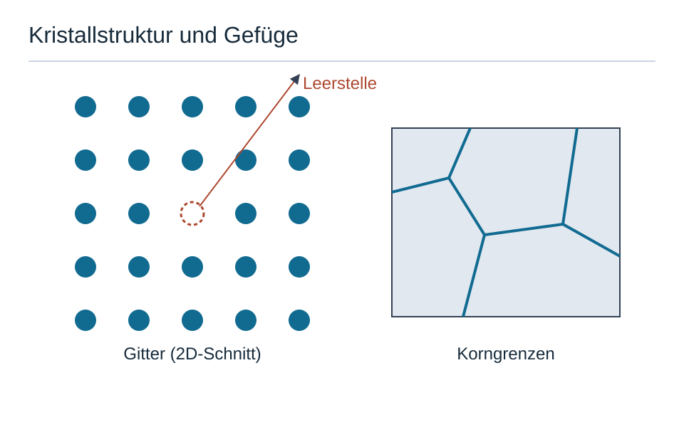

# M4-L1 – Kristallstruktur und Gefüge {#L1}

**Kursbereich:** M4 – Werkstoffe und Materialverhalten

**Niveau:** Bachelor

**Vorwissen:** [M1-L1 – Einheiten, Skalierung und Dimensionsanalyse](M1-L1.md)

**Lernziel:** Gitterstruktur, Defekte und Gefüge mit Werkstoffeigenschaften verknüpfen.

## Einstieg {#S1}

Zwei Bauteile gleicher chemischer Zusammensetzung können nach unterschiedlicher Verarbeitung verschiedene Härte und Zähigkeit besitzen.

## Grundlagen, Begriffe und Modell {#S2}

Kristalline Werkstoffe weisen periodische Atomanordnungen auf; amorphe Werkstoffe besitzen keine entsprechende Fernordnung. Bei kubisch-raumzentrierten (krz) und kubisch-flächenzentrierten (kfz) Strukturen enthält die konventionelle Elementarzelle effektiv zwei beziehungsweise vier Atome. Die theoretische Dichte lautet $\rho=nM/(N_Aa^3)$ mit Atomen je Zelle n, molarer Masse M, Avogadro-Konstante und Gitterparameter a.

Leerstellen, Fremdatome, Versetzungen und Korngrenzen sind unterschiedliche Defektarten. Versetzungsbewegung ermöglicht plastische Verformung. Korngrenzen behindern diese Bewegung häufig; die Festigkeit kann bei abnehmender Korngröße steigen. Gefüge umfasst auch Phasenanteile, Morphologie und Orientierung. Polykristalle können durch Textur anisotrop sein.

*Kristallgitter mit Leerstelle und polykristallines Gefüge.*

## Durchgerechnetes Beispiel {#S3}

Idealisierter kfz-Kristall: M = 0,06355 kg/mol, a = 0,3615 nm, n = 4. Mit N_A = 6,022·10²³ mol⁻¹ ergibt sich ρ ≈ 8935 kg/m³. Das entspricht der Größenordnung von Kupfer.

## Selbstkontrolle {#S4}

### Aufgaben

1. Wie viele Atome enthält eine konventionelle krz-Zelle effektiv?
2. Wie wirkt sich eine größere Zellkante bei gleichbleibender Zellmasse aus?

::: {.lc-solutions data-lc-section="S4"}
### Lösungen

1. 2.
2. Die Dichte sinkt proportional zu 1/a³.
:::

## Annahmen und Grenzen {#S5}

Die Dichteformel vernachlässigt Leerstellen, Porosität und Mehrphasigkeit. Korngrößeneffekte sind nicht universell über alle Größenbereiche.

## Zusammenfassung und Übergang {#S6}

Die atomare Struktur und das Gefüge sind Ausgangspunkte für die gezielte Werkstoffbehandlung.

**Weiterlesen:** [M4-L2 – Metalle und Wärmebehandlung](M4-L2.md)

## Quellen {#S7}

- [MIT OCW – Point & Line Defects](https://ocw.mit.edu/courses/3-091sc-introduction-to-solid-state-chemistry-fall-2010/pages/crystalline-materials/19-point-and-line-defects/) · Session 19 defects · Zuletzt abgerufen: 2026-11-25
- [MIT OCW – Fundamentals of Materials Science](https://ocw.mit.edu/courses/3-012-fundamentals-of-materials-science-fall-2005/) · Course description: structure, phase transformations, bonding · Zuletzt abgerufen: 2026-11-25

