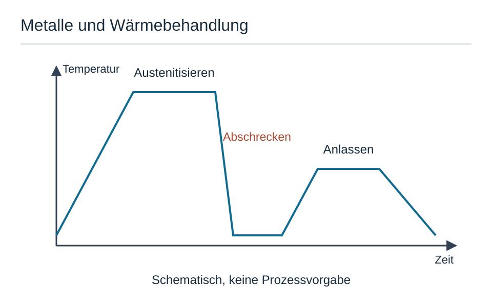

# M4-L2 – Metalle und Wärmebehandlung {#L2}

**Kursbereich:** M4 – Werkstoffe und Materialverhalten

**Niveau:** Bachelor

**Vorwissen:** [M4-L1 – Kristallstruktur und Gefüge](M4-L1.md)

**Lernziel:** Wärmebehandlungswege und die Rolle von Phasenumwandlungen erklären.

## Einstieg {#S1}

Eine Welle soll an der Oberfläche verschleißfest und im Kern ausreichend zäh sein. Dafür sind Zusammensetzung, Temperaturverlauf und Bauteilabmessungen gemeinsam zu betrachten.

## Grundlagen, Begriffe und Modell {#S2}

Legierungen können abhängig von Zusammensetzung und Temperatur unterschiedliche Phasen ausbilden. Das Gleichgewichtsphasendiagramm beschreibt stabile Phasen, aber nicht die Zeit, die zur Umwandlung nötig ist. Im Stahl können bei geeigneter Zusammensetzung und Austenitisierung beim langsamen Abkühlen diffusionsgesteuerte Gefüge entstehen; ausreichend schnelles Abkühlen kann Martensit bilden. Anlassen kann Härte reduzieren und Zähigkeit verbessern. Glühen kann Eigenspannungen abbauen oder Rekristallisation fördern.

Bei Aluminiumlegierungen ist dagegen häufig Ausscheidungshärtung relevant: Lösungsglühen, Abschrecken und Auslagern erzeugen fein verteilte Ausscheidungen, die Versetzungen behindern. Nicht jedes Metall lässt sich auf demselben Weg härten. Eine ideale Wärmemengenabschätzung ohne Umwandlung lautet Q = mcΔT.

*Schematischer Temperaturverlauf beim Härten und Anlassen von Stahl.*

## Durchgerechnetes Beispiel {#S3}

Ein 2-kg-Probekörper wird idealisiert von 20 °C auf 800 °C erwärmt; konstantes c = 500 J/(kg·K). Q = 2·500·780 = 780 kJ. Ofenverluste und Umwandlungsenthalpie sind nicht enthalten.

## Selbstkontrolle {#S4}

### Aufgaben

1. Warum reicht ein Gleichgewichtsdiagramm allein nicht für die Abschreckplanung?
2. Wie groß ist die ideale Wärmemenge bei doppelter Masse?

::: {.lc-solutions data-lc-section="S4"}
### Lösungen

1. Es enthält keine Umwandlungskinetik.
2. 1560 kJ.
:::

## Annahmen und Grenzen {#S5}

Keine Wärmebehandlungsanweisung: reale Temperaturen, Haltezeiten und Kühlmedien hängen von Werkstoffspezifikation, Geometrie und Sicherheitsbedingungen ab.

## Zusammenfassung und Übergang {#S6}

Phasenumwandlung und Kinetik bestimmen, welche Eigenschaften eine Behandlung erreichen kann.

**Weiterlesen:** [M4-L3 – Polymere, Keramiken und Verbunde](M4-L3.md)

## Quellen {#S7}

- [MIT OCW – Fundamentals of Materials Science](https://ocw.mit.edu/courses/3-012-fundamentals-of-materials-science-fall-2005/) · Course description: structure, phase transformations, bonding · Zuletzt abgerufen: 2026-11-25
- [MIT OCW – Mechanical Behavior of Materials](https://ocw.mit.edu/courses/3-22-mechanical-behavior-of-materials-spring-2008/) · Course description: deformation, creep, fatigue, fracture · Zuletzt abgerufen: 2026-11-25

