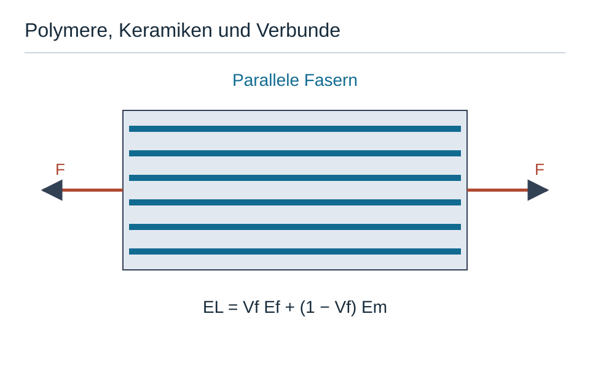

# M4-L3 – Polymere, Keramiken und Verbunde {#L3}

**Kursbereich:** M4 – Werkstoffe und Materialverhalten

**Niveau:** Bachelor

**Vorwissen:** [M4-L2 – Metalle und Wärmebehandlung](M4-L2.md)

**Lernziel:** Werkstoffklassen vergleichen und einen idealen Verbundmodul abschätzen.

## Einstieg {#S1}

Eine leichte Abdeckung, eine verschleißfeste Dichtung und ein hochbelasteter Träger benötigen unterschiedliche Werkstoffe.

## Grundlagen, Begriffe und Modell {#S2}

Thermoplaste lassen sich durch Erwärmen erweichen, Duroplaste besitzen ein vernetztes Gefüge und schmelzen nicht wie Thermoplaste. Elastomere ermöglichen große reversible Dehnungen. Zeit und Temperatur beeinflussen das mechanische Verhalten vieler Polymere erheblich. Keramiken besitzen häufig hohe Härte und Temperaturbeständigkeit, sind aber oft spröde und empfindlich gegenüber Zugspannungen und Fehlstellen.

In einem Faserverbund tragen Fasern Lasten bevorzugt in ihrer Richtung; die Matrix überträgt Kräfte zwischen ihnen und schützt sie. Für ideal gebundene kontinuierliche parallele Fasern bei gleicher axialer Dehnung gilt $E_L=V_fE_f+(1-V_f)E_m$. Quer zur Faser gelten andere Zusammenhänge. Die Orientierung ist daher Teil des Werkstoffmodells.

*Faserverbund unter Zug parallel zu den Fasern.*

## Durchgerechnetes Beispiel {#S3}

Faseranteil 0,6, Fasermodul 70 GPa, Matrixmodul 3 GPa. Längsmodul = 0,6·70 + 0,4·3 = 43,2 GPa. Bei 0,1 % axialer Dehnung ergibt sich eine mittlere Spannung von 43,2 MPa.

## Selbstkontrolle {#S4}

### Aufgaben

1. Wie hoch ist der Längsmodul bei 50 % Faseranteil?
2. Ist derselbe Modul ohne Weiteres quer zur Faser gültig?

::: {.lc-solutions data-lc-section="S4"}
### Lösungen

1. 36,5 GPa.
2. Nein, die Orientierung und Lastübertragung unterscheiden sich.
:::

## Annahmen und Grenzen {#S5}

Mischungsregel nur für ideale lineare Längsbelastung; keine Aussage zu Grenzflächenversagen, Delamination oder Ermüdung.

## Zusammenfassung und Übergang {#S6}

Werkstoffklasse und Struktur bestimmen die Auswahl eines geeigneten Materialmodells.

**Weiterlesen:** [M4-L4 – Werkstoffprüfung und Kennwerte](M4-L4.md)

## Quellen {#S7}

- [MIT OCW – Polymer Engineering](https://ocw.mit.edu/courses/3-064-polymer-engineering-fall-2003/) · Course description: selection, mechanical characterisation, processing · Zuletzt abgerufen: 2026-11-25
- [MIT OCW – Mechanics of Materials: Modules](https://ocw.mit.edu/courses/3-11-mechanics-of-materials-fall-1999/pages/modules/) · Module index: elasticity, composites, stress–strain, fatigue · Zuletzt abgerufen: 2026-11-25

