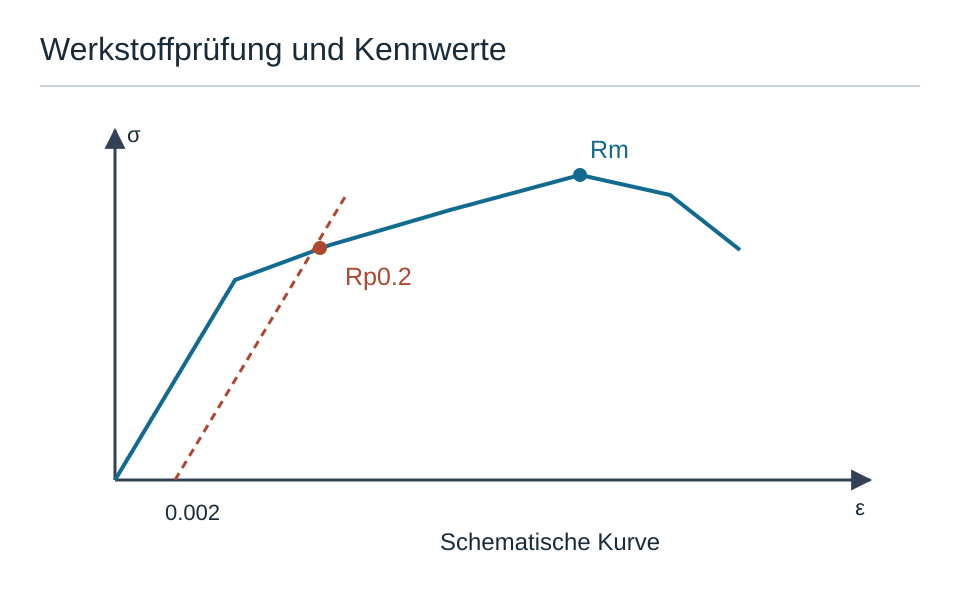

# M4-L4 – Werkstoffprüfung und Kennwerte {#L4}

**Kursbereich:** M4 – Werkstoffe und Materialverhalten

**Niveau:** Bachelor

**Vorwissen:** [M4-L3 – Polymere, Keramiken und Verbunde](M4-L3.md)

**Lernziel:** Kennwerte aus Zugversuchen unterscheiden und einfache Werte berechnen.

## Einstieg {#S1}

Ein Werkstoffdatenblatt nennt Elastizitätsmodul, Dehngrenze, Zugfestigkeit und Bruchdehnung. Diese Größen beantworten verschiedene Auslegungsfragen.

## Grundlagen, Begriffe und Modell {#S2}

Im Zugversuch werden Kraft F und Verlängerung ΔL erfasst. Technische Spannung $\sigma=F/A_0$ und technische Dehnung $\varepsilon=\Delta L/L_0$ beziehen sich auf die Anfangsgeometrie. Der Elastizitätsmodul E ist die Anfangssteigung im linear-elastischen Bereich. Die 0,2-%-Dehngrenze wird bei fehlender ausgeprägter Streckgrenze über die um 0,002 versetzte elastische Gerade bestimmt. Die Zugfestigkeit ist das Maximum der technischen Spannung; danach kann Einschnürung auftreten.

Härte beschreibt den Widerstand gegen lokales Eindringen nach einem definierten Verfahren, Kerbschlagarbeit den Energieverbrauch im jeweiligen Schlagversuch. Diese Prüfwerte sind nicht ohne Zusatzannahmen austauschbar. Probengeometrie, Prüftemperatur und Belastungsgeschwindigkeit sind zu dokumentieren.

*Schematische technische Spannungs-Dehnungs-Kurve mit 0,2-%-Dehngrenze.*

## Durchgerechnetes Beispiel {#S3}

Probe A₀ = 50 mm², L₀ = 100 mm. Bei 10 kN und elastischer Verlängerung 0,1 mm: σ = 200 MPa, ε = 0,001, E = 200 GPa. Bei maximaler Kraft 25 kN beträgt die Zugfestigkeit 500 MPa.

## Selbstkontrolle {#S4}

### Aufgaben

1. Welche technische Spannung entsteht bei 15 kN?
2. Ist die Zugfestigkeit identisch mit der Dehngrenze?

::: {.lc-solutions data-lc-section="S4"}
### Lösungen

1. 300 MPa.
2. Nein; maximale technische Spannung und Beginn definierter bleibender Dehnung sind verschieden.
:::

## Annahmen und Grenzen {#S5}

Das Beispiel ist kein Prüfprotokoll. Maschinensteifigkeit, Extensometer, Normproben und Messunsicherheit sind bei realen Prüfungen zu berücksichtigen.

## Zusammenfassung und Übergang {#S6}

Kennwerte müssen zur tatsächlichen Belastungsart und zum geprüften Werkstoffzustand passen.

**Weiterlesen:** [M4-L5 – Ermüdung, Bruch und Korrosion](M4-L5.md)

## Quellen {#S7}

- [MIT OCW – Mechanics of Materials: Modules](https://ocw.mit.edu/courses/3-11-mechanics-of-materials-fall-1999/pages/modules/) · Module index: elasticity, composites, stress–strain, fatigue · Zuletzt abgerufen: 2026-11-25
- [OpenStax – University Physics Volume 1, 12.3 Stress, Strain, and Elastic Modulus](https://openstax.org/books/university-physics-volume-1/pages/12-3-stress-strain-and-elastic-modulus) · §12.3: stress, strain, elastic modulus · Zuletzt abgerufen: 2026-11-25

