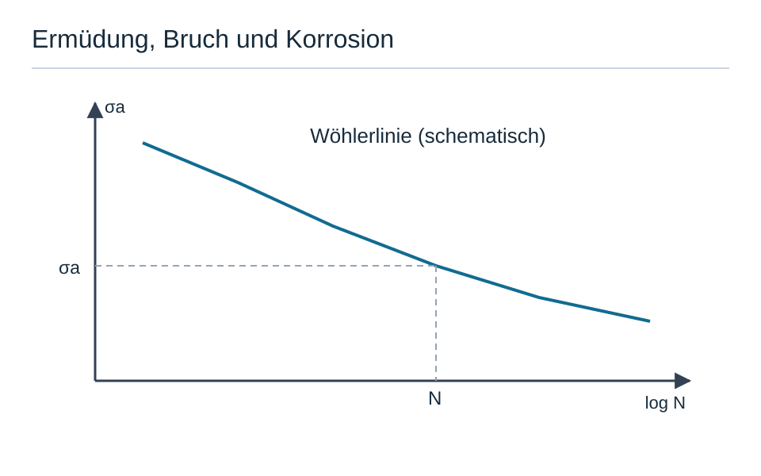

# M4-L5 – Ermüdung, Bruch und Korrosion {#L5}

**Kursbereich:** M4 – Werkstoffe und Materialverhalten

**Niveau:** Bachelor

**Vorwissen:** [M4-L4 – Werkstoffprüfung und Kennwerte](M4-L4.md)

**Lernziel:** Ermüdung, Risswachstum und Korrosionsschäden unterscheiden.

## Einstieg {#S1}

Eine umlaufende Welle kann durch wiederholte Biegung versagen, obwohl die höchste Nennspannung unter der statischen Streckgrenze bleibt.

## Grundlagen, Begriffe und Modell {#S2}

Bei zyklischer Belastung sind Spannungsamplitude $\sigma_a=(\sigma_{max}-\sigma_{min})/2$ und Mittelspannung $\sigma_m=(\sigma_{max}+\sigma_{min})/2$ wichtige Größen. Wöhlerlinien stellen die ertragbare Amplitude für eine bestimmte Lastspielzahl unter definierten Bedingungen dar. Kerben, Oberflächenzustand, Größe und Umwelt beeinflussen die Lebensdauer.

In der linear-elastischen Bruchmechanik charakterisiert $K_I=Y\sigma\sqrt{\pi a}$ die Beanspruchung eines Mode-I-Risses mit Rissgröße a und Geometriefaktor Y. Kritische Werte hängen von Werkstoff und Randbedingungen ab. Korrosion ist eine chemische oder elektrochemische Wechselwirkung mit der Umgebung; Lochfraß kann Kerben erzeugen, und Korrosionsermüdung kann die Lebensdauer verkürzen. Schutzmaßnahmen und Inspektionen ergänzen die rechnerische Auslegung.

*Schematische Wöhlerlinie mit abnehmender Spannungsamplitude.*

## Durchgerechnetes Beispiel {#S3}

Zyklus zwischen −60 und +140 MPa: σₐ = 100 MPa, σₘ = 40 MPa. Für einen separaten idealisierten Riss mit a = 2 mm, Y = 1 und Zugspannung 100 MPa ergibt sich K_I ≈ 7,93 MPa√m.

## Selbstkontrolle {#S4}

### Aufgaben

1. Welche Amplitude liegt bei Wechselbeanspruchung zwischen −80 und +80 MPa vor?
2. Wie ändert sich K_I bei vierfacher Rissgröße und ansonsten gleichen Modellgrößen?

::: {.lc-solutions data-lc-section="S4"}
### Lösungen

1. 80 MPa.
2. Es verdoppelt sich.
:::

## Annahmen und Grenzen {#S5}

Keine Freigabe eines realen Bauteils; Rissgeometrie, Plastizität, Lastkollektiv und Umwelteinfluss benötigen eigene Nachweise.

## Zusammenfassung und Übergang {#S6}

Schädigungsmechanismen müssen schon bei Werkstoffauswahl und Inspektionskonzept bedacht werden.

**Weiterlesen:** [M4-L6 – Werkstoffauswahl](M4-L6.md)

## Quellen {#S7}

- [MIT OCW – Fracture and Fatigue](https://ocw.mit.edu/courses/3-35-fracture-and-fatigue-fall-2003/) · Course description: fatigue, crack growth, corrosion fatigue · Zuletzt abgerufen: 2026-11-25
- [MIT OCW – Mechanical Behavior of Materials](https://ocw.mit.edu/courses/3-22-mechanical-behavior-of-materials-spring-2008/) · Course description: deformation, creep, fatigue, fracture · Zuletzt abgerufen: 2026-11-25

