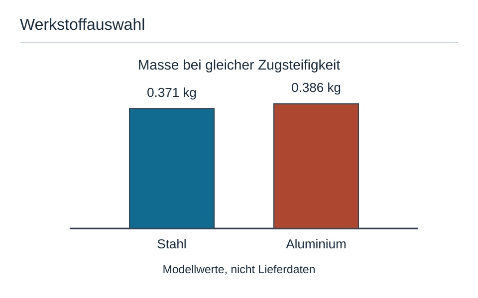

# M4-L6 – Werkstoffauswahl {#L6}

**Kursbereich:** M4 – Werkstoffe und Materialverhalten

**Niveau:** Bachelor

**Vorwissen:** [M4-L5 – Ermüdung, Bruch und Korrosion](M4-L5.md)

**Lernziel:** Werkstoffe nach Anforderungen, Restriktionen und einer geeigneten Zielgröße auswählen.

## Einstieg {#S1}

Eine Zugstrebe soll möglichst leicht sein und gleichzeitig eine maximale elastische Verlängerung einhalten. Der billigste oder festeste Werkstoff ist nicht zwangsläufig optimal.

## Grundlagen, Begriffe und Modell {#S2}

Zunächst werden Funktion, Randbedingungen, Ziel und freie Variablen festgelegt. Harte Anforderungen wie Betriebstemperatur oder Medienverträglichkeit dienen zum Ausschluss ungeeigneter Kandidaten. Die verbleibenden Kandidaten können mit einer abgeleiteten Zielgröße verglichen werden.

Für eine Zugstrebe mit Länge L und Kraft F gilt $\delta=FL/(EA)$ und Masse $m=\rho AL$. Wird A frei gewählt und ist die zulässige Verlängerung maßgebend, folgt $A\ge FL/(E\delta_{max})$ und somit $m_{min}=\rho FL^2/(E\delta_{max})$. Bei gleicher Aufgabe ist ein großes Verhältnis E/ρ günstig. Für Biegung, Festigkeits- oder Stabilitätsbegrenzung ergeben sich andere Indizes. Fertigung, Kosten, Reparatur und Recycling sind danach getrennt zu prüfen.

*Vergleich von Dichte und Elastizitätsmodul für zwei Modellwerkstoffe.*

## Durchgerechnetes Beispiel {#S3}

Idealwerte: Stahl E = 210 GPa, ρ = 7800 kg/m³; Aluminium E = 70 GPa, ρ = 2700 kg/m³. Bei F = 10 kN, L = 1 m, δ_max = 1 mm ergibt sich für Stahl A = 47,62 mm², m = 0,371 kg; für Aluminium A = 142,86 mm², m = 0,386 kg. In diesem Modell liegen beide nahe beieinander.

## Selbstkontrolle {#S4}

### Aufgaben

1. Welche Fläche benötigt Stahl bei halbierter zulässiger Verlängerung?
2. Warum darf der ermittelte Index nicht automatisch auf einen Biegeträger übertragen werden?

::: {.lc-solutions data-lc-section="S4"}
### Lösungen

1. 95,24 mm².
2. Die Steifigkeit hängt dort auch vom Flächenträgheitsmoment und der Querschnittsform ab.
:::

## Annahmen und Grenzen {#S5}

Idealwerte sind keine garantierten Lieferdaten. Anschlussgeometrie, Festigkeit, Korrosion, Kosten und Lastwechsel können die Rangfolge ändern.

## Zusammenfassung und Übergang {#S6}

Die Werkstoffauswahl ist eine prüfbare Optimierungsaufgabe, nicht nur ein Tabellenvergleich.

**Weiterlesen:** [M5-L1 – Systeme, Zustandsgrößen und Stoffmodelle](M5-L1.md)

## Quellen {#S7}

- [MIT OCW – Electronic and Mechanical Properties of Materials: Readings](https://ocw.mit.edu/courses/3-225-electronic-and-mechanical-properties-of-materials-fall-2007/pages/readings/) · Session 12 materials selection and performance indices · Zuletzt abgerufen: 2026-11-25
- [MIT OCW – Polymer Engineering](https://ocw.mit.edu/courses/3-064-polymer-engineering-fall-2003/) · Course description: selection, mechanical characterisation, processing · Zuletzt abgerufen: 2026-11-25

