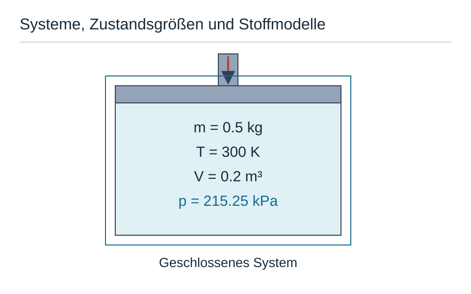

# M5-L1 – Systeme, Zustandsgrößen und Stoffmodelle {#L1}

**Kursbereich:** M5 – Thermodynamik

**Niveau:** Bachelor

**Vorwissen:** [M1-L1 – Einheiten, Skalierung und Dimensionsanalyse](M1-L1.md)

**Lernziel:** Systemgrenzen festlegen und ideale Gaszustände berechnen.

## Einstieg {#S1}

Ein Verdichter, ein Druckbehälter und ein Gas im Kolben unterscheiden sich durch den Stoffaustausch. Vor jeder Bilanz wird festgelegt, welches Objekt betrachtet wird.

## Grundlagen, Begriffe und Modell {#S2}

Ein geschlossenes System hat eine konstante Masse, da keine Masse die Systemgrenze überschreitet; ein offenes Kontrollvolumen kann Masse austauschen. Ein isoliertes System tauscht weder Masse noch Energie aus. Druck p, Temperatur T und Volumen V beschreiben den Gleichgewichtszustand; Masse und Volumen sind extensiv, Temperatur und Druck intensiv. Spezifische Größen beziehen sich auf ein Kilogramm, etwa $v=V/m$.

Für ein ideales Gas gilt $pV=nRT=mR_sT$, mit absolutem Druck und Kelvin-Temperatur. Für Luft wird näherungsweise $R_s=287\,\mathrm{J/(kg\,K)}$ verwendet. Der Kompressibilitätsfaktor $Z=pv/(R_sT)$ quantifiziert die Abweichung vom idealen Gas. Bei Phasenwechseln benötigt man Stofftabellen oder geeignete Zustandsgleichungen.

*Kolben-Zylinder-System mit Zustandsgrößen und Systemgrenze.*

## Durchgerechnetes Beispiel {#S3}

Ein geschlossener Behälter enthält 0,5 kg Luft bei 300 K und 0,2 m³. p = 0,5 · 287 · 300 / 0,2 = 215 250 Pa = 215,25 kPa absolut. Bei 100 kPa Umgebungsdruck zeigt ein Relativdrucksensor 115,25 kPa.

## Selbstkontrolle {#S4}

### Aufgaben

1. Wie ändert sich p bei 600 K und konstantem Volumen?
2. Ist eine stationär durchströmte Turbine geschlossen?

::: {.lc-solutions data-lc-section="S4"}
### Lösungen

1. Er verdoppelt sich auf 430,5 kPa.
2. Nein, Masse überschreitet die Grenze.
:::

## Annahmen und Grenzen {#S5}

Idealgasannahme bei mäßiger Dichte; kein Kondensat, keine Leckage. Absolute Temperaturen und Drücke verwenden.

## Zusammenfassung und Übergang {#S6}

Die Systemgrenze bestimmt die Bilanz, das Stoffmodell liefert die Zustände.

**Weiterlesen:** [M5-L2 – Erster Hauptsatz und Energiebilanzen](M5-L2.md)

## Quellen {#S7}

- [OpenStax – University Physics 2: Chapter 2 Key Equations](https://openstax.org/books/university-physics-volume-2/pages/2-key-equations) · Ideal gas law; equation of state · Zuletzt abgerufen: 2026-11-25
- [Purdue University – ME 200 Thermodynamics I](https://engineering.purdue.edu/ME200/) · Course scope: engineering devices and cycles · Zuletzt abgerufen: 2026-11-25

