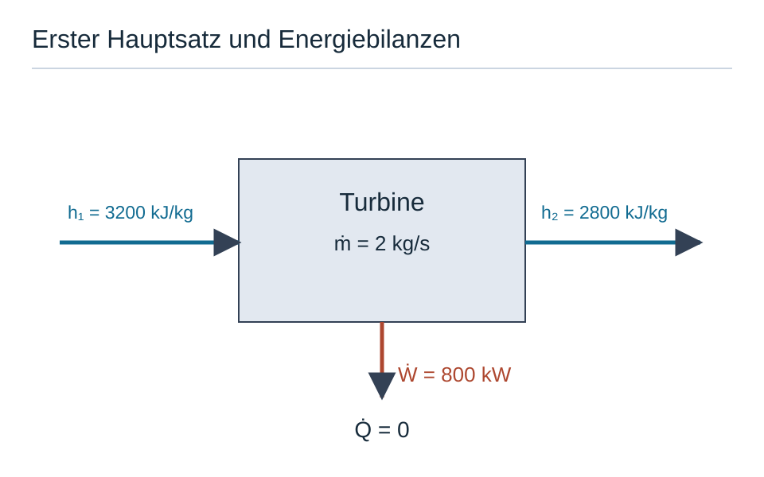

# M5-L2 – Erster Hauptsatz und Energiebilanzen {#L2}

**Kursbereich:** M5 – Thermodynamik

**Niveau:** Bachelor

**Vorwissen:** [M5-L1 – Systeme, Zustandsgrößen und Stoffmodelle](M5-L1.md)

**Lernziel:** Den ersten Hauptsatz für geschlossene und stationär offene Systeme anwenden.

## Einstieg {#S1}

Energie kann über Wärme, Arbeit oder Stoffströme transportiert werden. Die Vorzeichen müssen durchgängig zur gewählten Systemgrenze passen.

## Grundlagen, Begriffe und Modell {#S2}

Wir zählen Wärme Q in das System positiv und Arbeit W aus dem System positiv. Dann gilt $\Delta U+\Delta E_{kin}+\Delta E_{pot}=Q-W$. Die innere Energie U ist eine Zustandsgröße, Q und W hängen vom Prozessweg ab. Bei quasistatischer Volumenänderung ist $W_b=\int p\,dV$.

Im stationären Kontrollvolumen mit einem Ein- und Austritt gilt $\dot Q-\dot W_s=\dot m[(h_2-h_1)+(c_2^2-c_1^2)/2+g(z_2-z_1)]$. Die spezifische Enthalpie $h=u+pv$ enthält die Verschiebearbeit am Strömungsquerschnitt; die Wellenarbeit wird separat erfasst. Die Massenbilanz ist ebenso erforderlich.

*Energiebilanz eines Systems und einer durchströmten Turbine.*

## Durchgerechnetes Beispiel {#S3}

Eine adiabate Turbine verarbeitet 2 kg/s. h₁ = 3200 kJ/kg, h₂ = 2800 kJ/kg, Geschwindigkeits- und Höhenänderungen sind vernachlässigbar. Wellenleistung = 2 · (3200 − 2800) = 800 kW. Bei 20 kW Wärmeverlust und unverändertem Enthalpieabfall sowie Massenstrom bleiben 780 kW.

## Selbstkontrolle {#S4}

### Aufgaben

1. Ein starrer geschlossener Behälter erhält 50 kJ Wärme ohne sonstige Arbeit. ΔU?
2. Warum ist Enthalpie im Kontrollvolumen nützlich?

::: {.lc-solutions data-lc-section="S4"}
### Lösungen

1. 50 kJ bei unveränderter Lage und Geschwindigkeit.
2. Sie fasst innere Energie und Strömungsarbeit zusammen.
:::

## Annahmen und Grenzen {#S5}

Stationarität und vernachlässigte Energieterme müssen begründet werden. Enthalpien sind hier vorgegebene Modellwerte.

## Zusammenfassung und Übergang {#S6}

Energie bleibt erhalten, auch wenn nutzbare Arbeit durch Verluste sinkt.

**Weiterlesen:** [M5-L3 – Entropie und zweiter Hauptsatz](M5-L3.md)

## Quellen {#S7}

- [OpenStax – University Physics 2: Chapter 3 Key Equations](https://openstax.org/books/university-physics-volume-2/pages/3-key-equations) · First law and volume work · Zuletzt abgerufen: 2026-11-25
- [Purdue University – ME 200 Thermodynamics I](https://engineering.purdue.edu/ME200/) · Course scope: engineering devices and cycles · Zuletzt abgerufen: 2026-11-25

