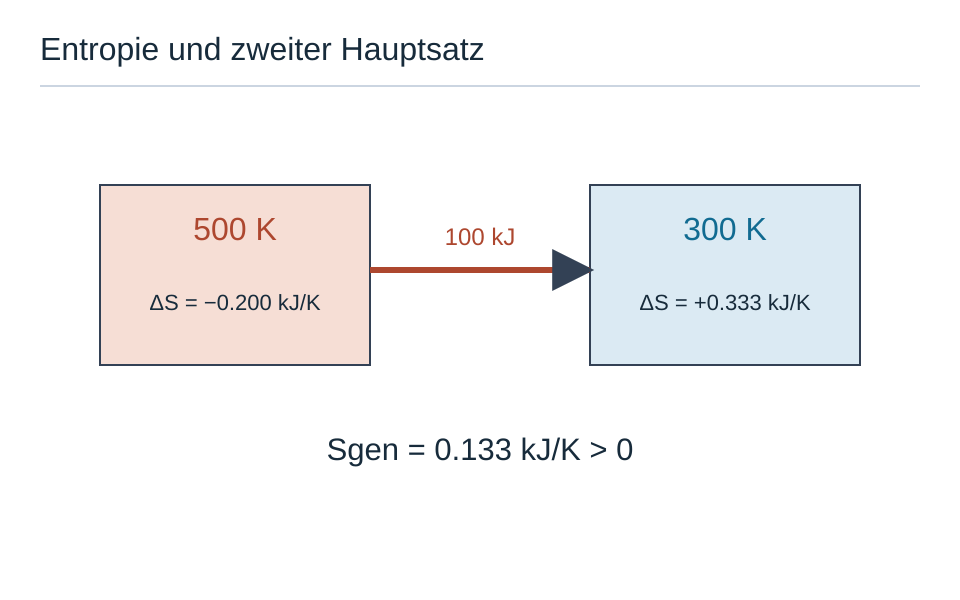

# M5-L3 – Entropie und zweiter Hauptsatz {#L3}

**Kursbereich:** M5 – Thermodynamik

**Niveau:** Bachelor

**Vorwissen:** [M5-L2 – Erster Hauptsatz und Energiebilanzen](M5-L2.md)

**Lernziel:** Entropiebilanzen aufstellen und irreversible Vorgänge erkennen.

## Einstieg {#S1}

Eine Energiebilanz allein erklärt nicht, warum Wärme spontan von warm nach kalt fließt. Der zweite Hauptsatz ergänzt die Richtung des Vorgangs.

## Grundlagen, Begriffe und Modell {#S2}

Entropie S ist eine Zustandsgröße in J/K. Für einen reversiblen Weg gilt $dS=\delta Q_{rev}/T$. Für ein geschlossenes System mit Wärmeübertragung bei Grenztemperatur $T_b$ lautet die Bilanz $\Delta S=\int\delta Q/T_b+S_{gen}$ mit $S_{gen}\ge0$. Reibung, Mischung und Wärmeübertragung über eine endliche Temperaturdifferenz erzeugen Entropie.

Für ein ideales Gas mit konstanten spezifischen Wärmekapazitäten gilt $\Delta s=c_p\ln(T_2/T_1)-R_s\ln(p_2/p_1)$. Ein adiabater reversibler Prozess ist isentrop; adiabatisch allein bedeutet nicht isentrop.

*Wärmestrom von einem warmen zu einem kalten Reservoir und Entropieerzeugung.*

## Durchgerechnetes Beispiel {#S3}

100 kJ fließen von 500 K zu 300 K. Das warme Reservoir verliert 0,200 kJ/K, das kalte gewinnt 0,3333 kJ/K. Gesamt: S_gen = 0,1333 kJ/K > 0. Die Energie bleibt erhalten.

## Selbstkontrolle {#S4}

### Aufgaben

1. Wie groß ist S_gen bei 200 kJ unter denselben Bedingungen?
2. Kann die Entropie eines einzelnen Systems abnehmen?

::: {.lc-solutions data-lc-section="S4"}
### Lösungen

1. 0,2667 kJ/K.
2. Ja, durch Entropieabfuhr; die Gesamtentropie eines isolierten Systems nimmt nicht ab.
:::

## Annahmen und Grenzen {#S5}

Reservoirtemperaturen bleiben konstant; alle Temperaturen absolut. Bei variablem c_p ist die passende Integration nötig.

## Zusammenfassung und Übergang {#S6}

Entropieerzeugung misst Irreversibilität, nicht Energievernichtung.

**Weiterlesen:** [M5-L4 – Kreisprozesse und Wärmekraftmaschinen](M5-L4.md)

## Quellen {#S7}

- [OpenStax – Entropy](https://openstax.org/books/university-physics-volume-2/pages/4-6-entropy) · §4.6 entropy change and second law · Zuletzt abgerufen: 2026-11-25
- [OpenStax – University Physics 2: Chapter 4 Key Equations](https://openstax.org/books/university-physics-volume-2/pages/4-key-equations) · Engine efficiency and coefficients of performance · Zuletzt abgerufen: 2026-11-25

