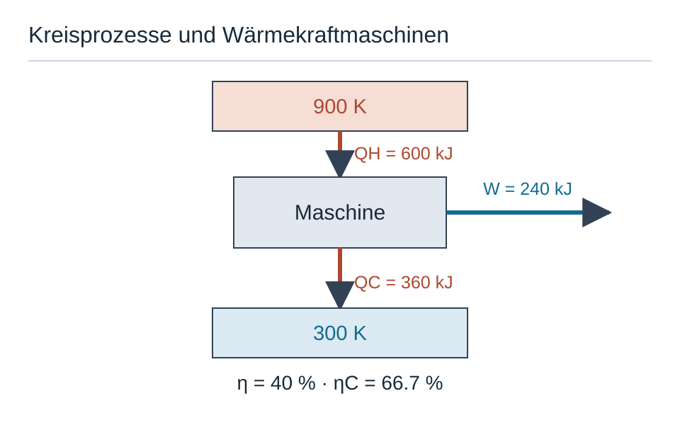

# M5-L4 – Kreisprozesse und Wärmekraftmaschinen {#L4}

**Kursbereich:** M5 – Thermodynamik

**Niveau:** Bachelor

**Vorwissen:** [M5-L3 – Entropie und zweiter Hauptsatz](M5-L3.md)

**Lernziel:** Kreisprozesse bilanzieren und Wirkungsgrade mit der Carnot-Grenze vergleichen.

## Einstieg {#S1}

Gasturbinen, Verbrennungsmotoren und Dampfkraftwerke wandeln thermische Energie teilweise in mechanische Arbeit um. Der Prozess kehrt zyklisch zum Ausgangszustand zurück.

## Grundlagen, Begriffe und Modell {#S2}

Im geschlossenen Kreisprozess ist $\Delta U=0$. Mit positiven Beträgen der zu- und abgeführten Wärmemengen pro Zyklus gilt $W_{net}=Q_H-Q_C$ und $\eta=W_{net}/Q_H$. Zwischen zwei Reservoiren ist die Obergrenze $\eta_C=1-T_C/T_H$ (Kelvin). Reale Prozesse liegen darunter.

Der ideale Otto-Prozess nutzt isentrope Verdichtung und Expansion sowie isochore Wärmezufuhr und -abfuhr. Der Brayton-Prozess modelliert Gasturbinen mit isobaren Wärmeschritten; der Rankine-Prozess nutzt Pumpe, Dampferzeuger, Turbine und Kondensator. Im p-V-Diagramm ist die eingeschlossene Fläche bei quasistatischem Prozess die Netto-Volumenarbeit.

*Wärmekraftmaschine mit zugeführter Wärme, Nutzarbeit und Abwärme.*

## Durchgerechnetes Beispiel {#S3}

Eine Maschine erhält 600 kJ bei 900 K und gibt 360 kJ an 300 K ab. W_net = 240 kJ, η = 40 %. Carnot-Grenze = 1 − 300/900 = 66,7 %. Der angegebene Wirkungsgrad verletzt diese Grenze nicht.

## Selbstkontrolle {#S4}

### Aufgaben

1. Welche Nettoarbeit hat ein reversibler Prozess bei derselben Wärmezufuhr?
2. Warum kann eine Maschine nicht die gesamte zugeführte Wärme eines einzelnen Reservoirs in Arbeit umwandeln?

::: {.lc-solutions data-lc-section="S4"}
### Lösungen

1. 400 kJ.
2. Ein zyklischer Prozess benötigt nach dem zweiten Hauptsatz Entropieabfuhr.
:::

## Annahmen und Grenzen {#S5}

Carnot gilt für zwei Reservoirtemperaturen, nicht pauschal für beliebige variable Wärmequellen. Reale Motoren erfordern Verlust- und Stoffmodelle.

## Zusammenfassung und Übergang {#S6}

Vergleiche Kreisprozesse über Nettoarbeit, Wärmezufuhr und thermodynamische Grenzen.

**Weiterlesen:** [M5-L5 – Kältemaschinen und Wärmepumpen](M5-L5.md)

## Quellen {#S7}

- [OpenStax – University Physics 2: Chapter 4 Key Equations](https://openstax.org/books/university-physics-volume-2/pages/4-key-equations) · Engine efficiency and coefficients of performance · Zuletzt abgerufen: 2026-11-25
- [Purdue University – ME 200 Thermodynamics I](https://engineering.purdue.edu/ME200/) · Course scope: engineering devices and cycles · Zuletzt abgerufen: 2026-11-25

