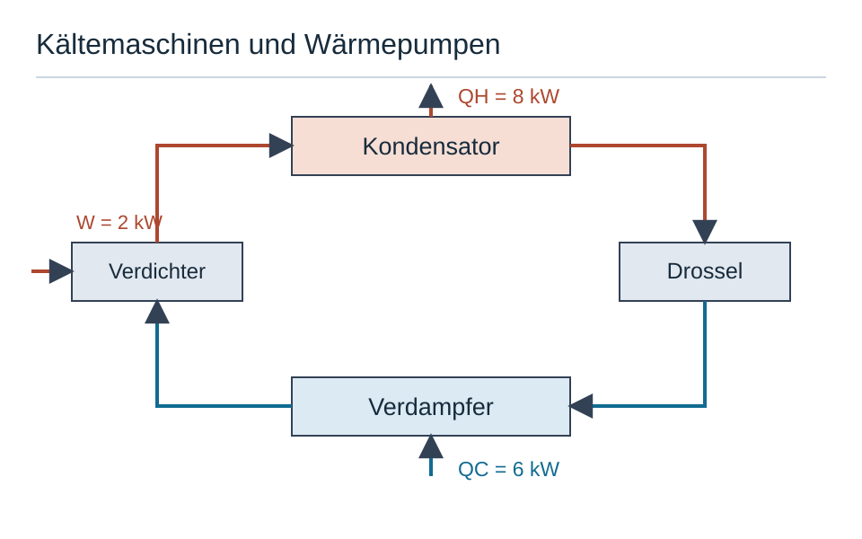

# M5-L5 – Kältemaschinen und Wärmepumpen {#L5}

**Kursbereich:** M5 – Thermodynamik

**Niveau:** Bachelor

**Vorwissen:** [M5-L4 – Kreisprozesse und Wärmekraftmaschinen](M5-L4.md)

**Lernziel:** Leistungszahlen berechnen und den Dampfkompressionsprozess erklären.

## Einstieg {#S1}

Kühlschränke und Wärmepumpen nutzen Arbeit, um Wärme gegen das natürliche Temperaturgefälle zu transportieren. Der Nutzen hängt davon ab, welche Seite betrachtet wird.

## Grundlagen, Begriffe und Modell {#S2}

Mit positiven Beträgen gilt $Q_H=Q_C+W$. Die Kälteleistungszahl ist $COP_R=Q_C/W$, die Heizleistungszahl $COP_H=Q_H/W=COP_R+1$. Reversible Grenzwerte sind $COP_{R,C}=T_C/(T_H-T_C)$ und $COP_{H,C}=T_H/(T_H-T_C)$.

Im Verdampfer nimmt das Kältemittel Wärme auf; der Verdichter erhöht den Druck; der Kondensator gibt Wärme ab; die Drossel senkt den Druck bei näherungsweise konstanter Enthalpie. Ein p-h-Diagramm erlaubt die Energiebilanz pro kg Kältemittel.

*Kältekreislauf mit Verdichter, Kondensator, Drossel und Verdampfer.*

## Durchgerechnetes Beispiel {#S3}

Eine Wärmepumpe nimmt 6 kW Umweltwärme auf und benötigt 2 kW Leistung. Heizleistung = 8 kW, COP_H = 4, COP_R = 3. Für Reservoirtemperaturen 280 K und 320 K beträgt die reversible Heizgrenze 8.

## Selbstkontrolle {#S4}

### Aufgaben

1. Wie viel elektrische Leistung ist für 12 kW Heizleistung bei COP = 3 nötig?
2. Warum kann COP größer als eins sein?

::: {.lc-solutions data-lc-section="S4"}
### Lösungen

1. 4 kW, bei gleicher Bilanzgrenze.
2. Zusätzlich zur Arbeit wird Wärme aus der Umgebung übertragen.
:::

## Annahmen und Grenzen {#S5}

Konstante Betriebsbedingungen; saisonale Effizienz umfasst zusätzlich Teillast, Hilfsantriebe und Abtauung. Kältemittelsicherheit separat beachten.

## Zusammenfassung und Übergang {#S6}

Die Leistungszahl bewertet den gewünschten Wärmestrom pro zugeführter Arbeit.

**Weiterlesen:** [M5-L6 – Exergie und irreversible Prozesse](M5-L6.md)

## Quellen {#S7}

- [OpenStax – University Physics 2: Chapter 4 Key Equations](https://openstax.org/books/university-physics-volume-2/pages/4-key-equations) · Engine efficiency and coefficients of performance · Zuletzt abgerufen: 2026-11-25
- [Purdue University – ME 200 Thermodynamics I](https://engineering.purdue.edu/ME200/) · Course scope: engineering devices and cycles · Zuletzt abgerufen: 2026-11-25

