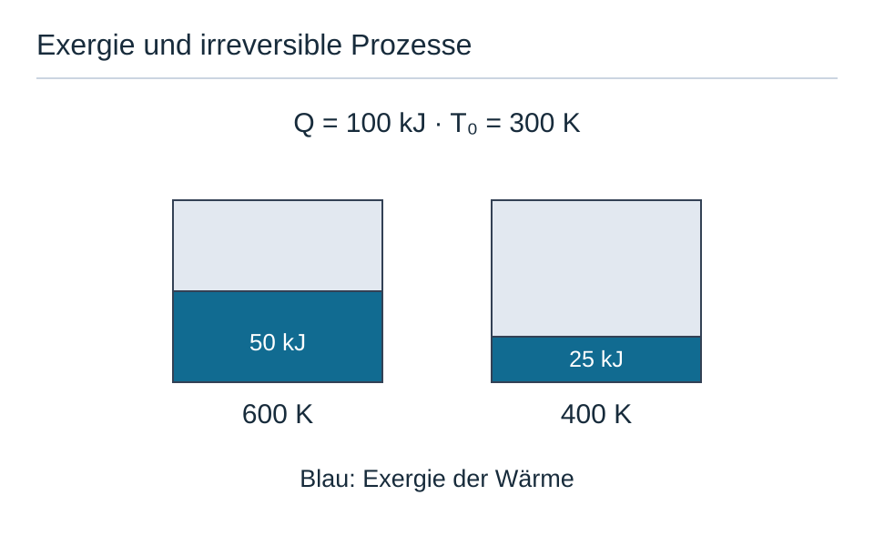

# M5-L6 – Exergie und irreversible Prozesse {#L6}

**Kursbereich:** M5 – Thermodynamik

**Niveau:** Bachelor

**Vorwissen:** [M5-L5 – Kältemaschinen und Wärmepumpen](M5-L5.md)

**Lernziel:** Exergie und Energie unterscheiden und Exergievernichtung berechnen.

## Einstieg {#S1}

Eine Kilowattstunde Wärme knapp oberhalb der Umgebungstemperatur ist energetisch gleich groß wie eine Kilowattstunde Hochtemperaturwärme, aber ihr Arbeitspotenzial unterscheidet sich.

## Grundlagen, Begriffe und Modell {#S2}

Exergie ist die maximal gewinnbare Nutzarbeit beim reversiblen Übergang in das Gleichgewicht mit einer definierten Umgebung $(T_0,p_0)$. Für die aus einem Reservoir bei konstanter Temperatur T > T₀ übertragene Wärme Q (positiv bei Zufuhr über die betrachtete Systemgrenze) ergibt sich aus dem Carnot-Faktor $B_Q=Q(1-T_0/T)$. 

Für Irreversibilität gilt die Gouy-Stodola-Beziehung $B_{dest}=T_0 S_{gen}$. Anders als Energie wird Exergie bei irreversiblen Vorgängen vernichtet. Die Bilanz unterscheidet daher abgeführte Exergie von intern vernichteter Exergie; eine Exergieeffizienz muss den gewünschten Nutzen und Aufwand ausdrücklich definieren.

*Exergie einer Wärmemenge bei zwei Temperaturniveaus relativ zur Umgebung.*

## Durchgerechnetes Beispiel {#S3}

100 kJ Wärme bei 600 K enthalten bei T₀ = 300 K maximal 50 kJ Arbeitspotenzial; bei 400 K nur 25 kJ. Werden die 100 kJ direkt von 600 K auf 400 K übertragen, entsteht S_gen = 100/400 − 100/600 = 0,08333 kJ/K. Exergievernichtung = 25 kJ.

## Selbstkontrolle {#S4}

### Aufgaben

1. Wie viel Exergie besitzt Wärme bei T = T₀?
2. Ist Exergieabfuhr dasselbe wie Exergievernichtung?

::: {.lc-solutions data-lc-section="S4"}
### Lösungen

1. Null relativ zu dieser Umgebung.
2. Nein. Abgeführte Exergie kann außerhalb der Grenze noch nutzbar sein.
:::

## Annahmen und Grenzen {#S5}

Konstante Umgebungs- und Reservoirtemperaturen; chemische Exergie und komplexe Stoffgemische sind hier nicht bilanziert.

## Zusammenfassung und Übergang {#S6}

Exergieanalysen lokalisieren thermodynamische Verluste und ergänzen Energiebilanzen.

**Weiterlesen:** [M6-L1 – Hydrostatik und Auftrieb](M6-L1.md)

## Quellen {#S7}

- [MIT OCW – Advanced Thermodynamics: Lecture Notes](https://ocw.mit.edu/courses/2-43-advanced-thermodynamics-spring-2024/resources/lecture-notes/) · Lectures 2 and 5: entropy, availability and efficiencies · Zuletzt abgerufen: 2026-11-25
- [OpenStax – Entropy](https://openstax.org/books/university-physics-volume-2/pages/4-6-entropy) · §4.6 entropy change and second law · Zuletzt abgerufen: 2026-11-25
- [OpenStax – University Physics 2: Chapter 4 Key Equations](https://openstax.org/books/university-physics-volume-2/pages/4-key-equations) · Engine efficiency and coefficients of performance · Zuletzt abgerufen: 2026-11-25

