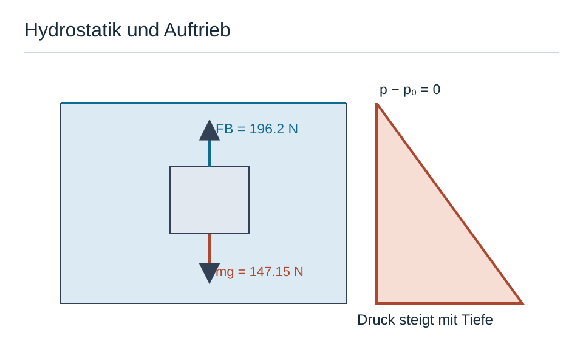

# M6-L1 – Hydrostatik und Auftrieb {#L1}

**Kursbereich:** M6 – Strömungsmechanik und Wärmetransport

**Niveau:** Bachelor

**Vorwissen:** [M1-L1 – Einheiten, Skalierung und Dimensionsanalyse](M1-L1.md)

**Lernziel:** Hydrostatische Drücke und Auftriebskräfte bestimmen.

## Einstieg {#S1}

Behälterwände, Schiffe und hydraulische Anlagen werden durch Druckkräfte belastet. Bei ruhenden Flüssigkeiten hängt der Druck von der Tiefe ab.

## Grundlagen, Begriffe und Modell {#S2}

Bei konstanter Dichte ρ und nach oben gerichteter z-Achse gilt $dp/dz=-\rho g$. In der Tiefe h unter einer Oberfläche mit Druck p₀ folgt $p=p_0+\rho gh$. Der Relativdruck ist die Differenz zum Umgebungsdruck. Bei einer freien Oberfläche unter Umgebungsdruck ist er gleich ρgh. Die Druckkraft auf eine ebene Fläche (einseitige Belastung, konsistenter Druckbezug) ist bei linearer Druckverteilung $F=p_{Schwerpunkt} A$; ihre Wirkungslinie liegt bei geneigten oder vertikalen Flächen im Allgemeinen nicht im Flächenschwerpunkt.

Aus der Integration des Drucks über die Oberfläche eines eingetauchten Körpers folgt der Auftrieb $F_A=\rho g V_{verdrängt}$. Frei schwimmende Körper verdrängen im statischen Gleichgewicht eine Flüssigkeitsmasse, die ihrer eigenen Masse entspricht.

*Hydrostatischer Druckverlauf und Auftrieb an einem eingetauchten Körper.*

## Durchgerechnetes Beispiel {#S3}

In Wasser mit ρ = 1000 kg/m³ beträgt in 3 m Tiefe der Überdruck 29,43 kPa. Ein vollständig eingetauchter Körper verdrängt 0,020 m³: Auftrieb = 196,2 N. Bei 15 kg Masse ist die resultierende Kraft ohne Halterung 49,05 N nach oben.

## Selbstkontrolle {#S4}

### Aufgaben

1. Welchen Überdruck ergibt eine Tiefe von 6 m?
2. Welches Wasservolumen verdrängt der frei schwimmende 15-kg-Körper?

::: {.lc-solutions data-lc-section="S4"}
### Lösungen

1. 58,86 kPa.
2. 0,015 m³.
:::

## Annahmen und Grenzen {#S5}

Ruhende inkompressible Flüssigkeit und konstantes g. Beschleunigte Behälter und Schichtung benötigen erweiterte Modelle.

## Zusammenfassung und Übergang {#S6}

Druck nimmt mit Tiefe zu; Auftrieb ergibt sich aus der verdrängten Flüssigkeit.

**Weiterlesen:** [M6-L2 – Kontinuität und Bernoulli-Gleichung](M6-L2.md)

## Quellen {#S7}

- [OpenStax – University Physics 1: Chapter 14 Key Equations](https://openstax.org/books/university-physics-volume-1/pages/14-key-equations) · Hydrostatics, continuity, Bernoulli · Zuletzt abgerufen: 2026-11-25

