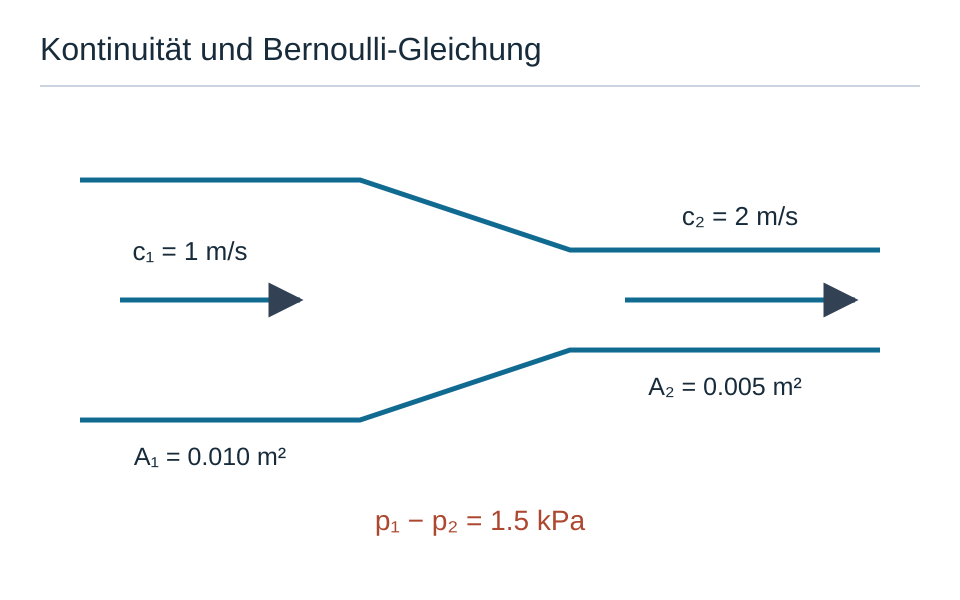

# M6-L2 – Kontinuität und Bernoulli-Gleichung {#L2}

**Kursbereich:** M6 – Strömungsmechanik und Wärmetransport

**Niveau:** Bachelor

**Vorwissen:** [M6-L1 – Hydrostatik und Auftrieb](M6-L1.md)

**Lernziel:** Massen- und mechanische Energiebilanz einer stationären Strömung anwenden.

## Einstieg {#S1}

In Düsen wandelt sich Druckenergie in Bewegungsenergie um. Wie viel Fluid pro Sekunde hindurchfließt, folgt unabhängig davon aus der Massenerhaltung.

## Grundlagen, Begriffe und Modell {#S2}

Für stationäre Strömung ohne Abzweigung gilt $\dot m=\rho A\bar c$ konstant. Bei inkompressibler Strömung ist der Volumenstrom $\dot V=A\bar c$ konstant. Für ein reibungsfreies, stationäres, inkompressibles Fluid entlang einer Stromlinie gilt $p+\rho c^2/2+\rho gz=\mathrm{const}$. Jeder Term besitzt die Einheit Pa.

Bei realen Rohrsystemen müssen Verluste und Pumpenarbeit ergänzt werden. Die einfache Bernoulli-Gleichung enthält keine Rohrreibungsverluste; über Querschnitte gemittelte Energiebilanzen benötigen bei ungleichförmigen Profilen gegebenenfalls Korrekturfaktoren.

*Rohrverengung mit Querschnitt, Geschwindigkeit und statischem Druck.*

## Durchgerechnetes Beispiel {#S3}

Wasser strömt horizontal mit 1 m/s durch A₁ = 0,010 m², anschließend A₂ = 0,005 m². Volumenstrom = 0,010 m³/s, c₂ = 2 m/s. Idealisiert ist p₁ − p₂ = 1000 · (4 − 1)/2 = 1500 Pa.

## Selbstkontrolle {#S4}

### Aufgaben

1. Wie groß ist c₂ bei A₂ = A₁/4?
2. Darf Bernoulli ohne Zusatzterm über eine Pumpe angewendet werden?

::: {.lc-solutions data-lc-section="S4"}
### Lösungen

1. 4 m/s bei konstantem Volumenstrom.
2. Nein, die zugeführte mechanische Energie muss bilanziert werden.
:::

## Annahmen und Grenzen {#S5}

Keine Kavitation, keine Kompressibilität, keine Reibung im Idealbeispiel. Der statische Druck muss absolut noch über dem Dampfdruck liegen.

## Zusammenfassung und Übergang {#S6}

Kontinuität liefert Geschwindigkeiten, Bernoulli den idealen Druckzusammenhang.

**Weiterlesen:** [M6-L3 – Rohrströmung und Druckverluste](M6-L3.md)

## Quellen {#S7}

- [OpenStax – University Physics 1: Chapter 14 Key Equations](https://openstax.org/books/university-physics-volume-1/pages/14-key-equations) · Hydrostatics, continuity, Bernoulli · Zuletzt abgerufen: 2026-11-25

