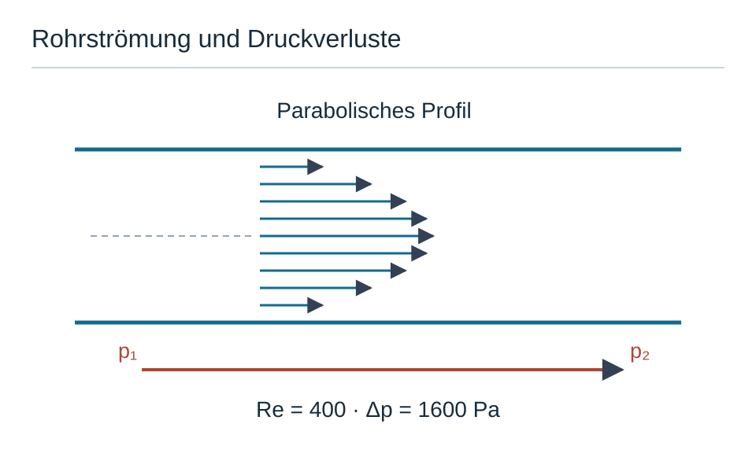

# M6-L3 – Rohrströmung und Druckverluste {#L3}

**Kursbereich:** M6 – Strömungsmechanik und Wärmetransport

**Niveau:** Bachelor

**Vorwissen:** [M6-L2 – Kontinuität und Bernoulli-Gleichung](M6-L2.md)

**Lernziel:** Rohrreibungsverluste berechnen und die Reynolds-Zahl einordnen.

## Einstieg {#S1}

Eine Rohrleitung kann auch bei konstanter Höhe und konstantem Durchmesser Druck verlieren. Ursache ist viskose Dissipation.

## Grundlagen, Begriffe und Modell {#S2}

Die Reynolds-Zahl $Re=\rho\bar c D/\mu$ vergleicht Trägheits- mit Zähigkeitseffekten. Für eine voll entwickelte laminare Strömung eines Newtonschen Fluids im Kreisrohr gilt nach Poiseuille $\Delta p=32\mu L\bar c/D^2$. Dies entspricht der Darcy-Weisbach-Gleichung $\Delta p=f_D (L/D)\rho\bar c^2/2$ mit $f_D=64/Re$.

Für turbulente Strömung hängt der Darcy-Reibungsbeiwert von Re und relativer Rauheit ab; er ist nicht der um Faktor vier kleinere Fanning-Beiwert. Lokale Verluste lassen sich näherungsweise über $\Delta p_{lok}=\sum K\rho\bar c^2/2$ erfassen, wenn die passende Bezugsgeschwindigkeit verwendet wird.

*Druckabfall im Rohr mit parabolischem Geschwindigkeitsprofil.*

## Durchgerechnetes Beispiel {#S3}

Ein Fluid mit ρ = 1000 kg/m³, μ = 0,010 Pa·s fließt mit 0,2 m/s durch D = 0,020 m, L = 10 m. Re = 400, f_D = 0,16. Druckverlust = 1600 Pa. Volumenstrom ≈ 0,00006283 m³/s, hydraulische Leistung ≈ 0,1005 W.

## Selbstkontrolle {#S4}

### Aufgaben

1. Wie ändert sich der laminare Druckverlust bei doppelter Geschwindigkeit?
2. Warum muss der Einlaufbereich gesondert betrachtet werden?

::: {.lc-solutions data-lc-section="S4"}
### Lösungen

1. Er verdoppelt sich, sofern die Strömung laminar bleibt.
2. Das Geschwindigkeitsprofil ist dort noch nicht voll entwickelt.
:::

## Annahmen und Grenzen {#S5}

Gerades Kreisrohr, voll entwickelte laminare Strömung, konstante Stoffwerte. Übergangsströmung ist störungsabhängig, lokale Verluste fehlen im Beispiel.

## Zusammenfassung und Übergang {#S6}

Reibungsmodelle müssen zum Strömungsregime und zur Geometrie passen.

**Weiterlesen:** [M6-L4 – Grenzschichten und Turbulenz](M6-L4.md)

## Quellen {#S7}

- [OpenStax – Viscosity and Turbulence](https://openstax.org/books/university-physics-volume-1/pages/14-7-viscosity-and-turbulence) · §14.7: laminar flow and Poiseuille law · Zuletzt abgerufen: 2026-11-25
- [OpenStax – University Physics 1: Chapter 14 Key Equations](https://openstax.org/books/university-physics-volume-1/pages/14-key-equations) · Hydrostatics, continuity, Bernoulli · Zuletzt abgerufen: 2026-11-25

