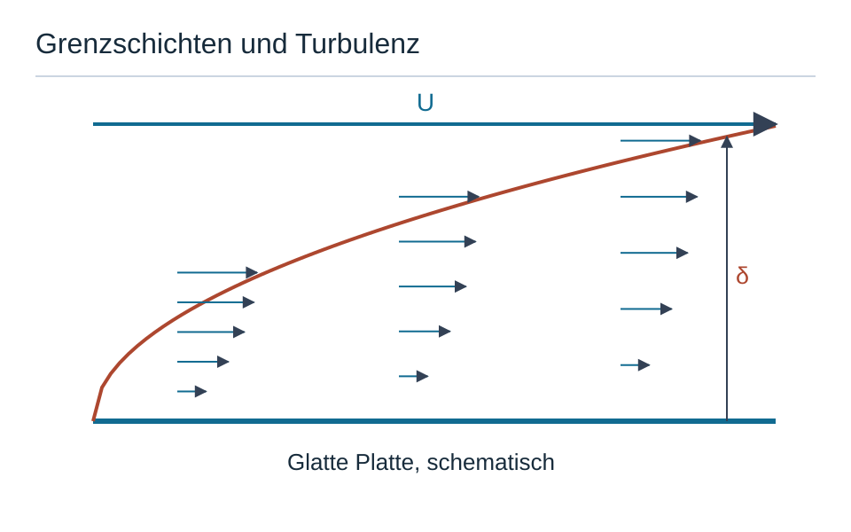

# M6-L4 – Grenzschichten und Turbulenz {#L4}

**Kursbereich:** M6 – Strömungsmechanik und Wärmetransport

**Niveau:** Bachelor

**Vorwissen:** [M6-L3 – Rohrströmung und Druckverluste](M6-L3.md)

**Lernziel:** Grenzschicht, Wandreibung, Transition und Ablösung unterscheiden.

## Einstieg {#S1}

Bei einer umströmten Tragfläche oder einem Fahrzeug entscheidet die wandnahe Strömung wesentlich über Widerstand und Wärmeübergang.

## Grundlagen, Begriffe und Modell {#S2}

Bei einem viskosen Fluid gilt an einer ruhenden Wand näherungsweise die Haftbedingung $u=0$. Die Geschwindigkeit nähert sich außerhalb der Grenzschicht der Außenströmung U. Die Grenzschichtdicke δ wird häufig an der Stelle $u=0.99U$ definiert. Die Wandschubspannung ist für Newtonsche Fluide $\tau_w=\mu(\partial u/\partial y)_w$.

Für die laminare Blasius-Grenzschicht an einer glatten ebenen Platte ohne Druckgradient gilt näherungsweise $\delta\approx5x/\sqrt{Re_x}$ mit $Re_x=Ux/\nu$. Turbulente Grenzschichten besitzen instationäre Schwankungen und verstärkten Impulsaustausch. Bei ungünstigem Druckgradienten kann die wandnahe Strömung verzögern und ablösen.

*Wachsende Grenzschicht entlang einer Platte und Geschwindigkeitsprofile.*

## Durchgerechnetes Beispiel {#S3}

Luft strömt mit U = 10 m/s über eine Platte, ν = 1,5·10⁻⁵ m²/s. Bei x = 0,30 m: Re_x = 200 000, δ ≈ 5 · 0,30 / √200 000 = 3,35 mm, sofern die Grenzschicht laminar ist.

## Selbstkontrolle {#S4}

### Aufgaben

1. Wie skaliert δ mit x im laminaren Modell?
2. Warum kann man keinen universellen Transitionspunkt angeben?

::: {.lc-solutions data-lc-section="S4"}
### Lösungen

1. Mit der Quadratwurzel aus x bei konstantem U und ν.
2. Rauheit, Druckgradient und äußere Störungen beeinflussen die Transition.
:::

## Annahmen und Grenzen {#S5}

Blasius gilt nur bei laminarer inkompressibler Strömung an der glatten Platte ohne Druckgradient. Keine direkte Übertragung auf abgelöste Strömung.

## Zusammenfassung und Übergang {#S6}

Die wandnahe Strömung verbindet Viskosität mit globalem Widerstand und Wärmeübergang.

**Weiterlesen:** [M6-L5 – Wärmeleitung, Konvektion und Strahlung](M6-L5.md)

## Quellen {#S7}

- [MIT OCW – Transport Phenomena in Materials Engineering: Flow Past a Flat Plate](https://ocw.mit.edu/courses/3-185-transport-phenomena-in-materials-engineering-fall-2003/a55c74dc21def01fc0054de35574d1e5_3_21.pdf) · §3.2.1 und §3.2.3, Gleichungen (75)–(80), (84)–(86): Haftbedingung, laminare Blasius-Grenzschichtdicke und Wandschubspannung; Übergang und Ablösung separat behandelt · Zuletzt abgerufen: 2026-11-25 · Inhaltlich geprüft: 2026-11-25
- [MIT OCW – Boundary Layers, Separation, and Drag](https://ocw.mit.edu/courses/2-25-advanced-fluid-mechanics-fall-2013/pages/boundary-layers-separation-and-drag/) · Blasius solution reading list · Zuletzt abgerufen: 2026-11-25
- [OpenStax – Viscosity and Turbulence](https://openstax.org/books/university-physics-volume-1/pages/14-7-viscosity-and-turbulence) · §14.7: laminar flow and Poiseuille law · Zuletzt abgerufen: 2026-11-25

