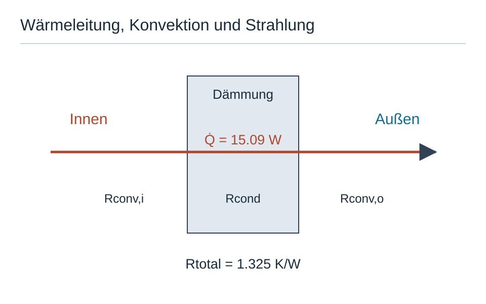

# M6-L5 – Wärmeleitung, Konvektion und Strahlung {#L5}

**Kursbereich:** M6 – Strömungsmechanik und Wärmetransport

**Niveau:** Bachelor

**Vorwissen:** [M6-L4 – Grenzschichten und Turbulenz](M6-L4.md)

**Lernziel:** Thermische Widerstände kombinieren und Strahlung getrennt bilanzieren.

## Einstieg {#S1}

Bei einer gedämmten Wand wirken mehrere Transportmechanismen gleichzeitig. Widerstandsmodelle machen den stationären Wärmestrom berechenbar.

## Grundlagen, Begriffe und Modell {#S2}

Für eindimensionale stationäre Wärmeleitung gilt $\dot Q=kA(T_1-T_2)/L$. Der Leitwiderstand ist $R_{cond}=L/(kA)$. Konvektion wird durch $\dot Q=hA(T_s-T_\infty)$ und $R_{conv}=1/(hA)$ beschrieben. In Reihe addieren sich Widerstände; bei konstantem stationärem Wärmestrom gilt $\dot Q=\Delta T/\sum R$.

Eine kleine diffuse graue Oberfläche in einer großen isothermen Umgebung (Sichtfaktor zur Umgebung eins, deren Bestrahlungsstärke näherungsweise der eines schwarzen Körpers entspricht), tauscht netto näherungsweise $\dot Q_{rad}=\epsilon\sigma A(T_s^4-T_{sur}^4)$ aus. Dabei ist $\sigma\approx5.67\cdot10^{-8}\,\mathrm{W/(m^2K^4)}$. Strahlung und Konvektion an derselben Fläche wirken parallel; die Strahlung ist temperaturabhängig.

*Wärmeleitung durch eine Wand und Konvektion an beiden Oberflächen.*

## Durchgerechnetes Beispiel {#S3}

A = 2 m², L = 0,10 m, k = 0,04 W/(m K), h innen = 10, h außen = 20 W/(m² K). Widerstände: 1,25 + 0,05 + 0,025 = 1,325 K/W. Bei 20 K Differenz ergibt sich 15,09 W ohne Strahlung.

## Selbstkontrolle {#S4}

### Aufgaben

1. Welche Leitwiderstandswerte ergeben sich bei doppelter Dicke?
2. Warum benötigt das Strahlungsgesetz Kelvin?

::: {.lc-solutions data-lc-section="S4"}
### Lösungen

1. 2,5 K/W.
2. Die vierte Potenz bezieht sich auf die absolute Temperatur.
:::

## Annahmen und Grenzen {#S5}

Stationär, eindimensional, konstante Stoffwerte, keine Wärmebrücken. h hängt von Geometrie, Strömung und Stoffwerten ab.

## Zusammenfassung und Übergang {#S6}

Widerstände vereinfachen Wärmebilanzen; Strahlung bleibt ohne Linearisierung nichtlinear.

**Weiterlesen:** [M6-L6 – Wärmeübertrager](M6-L6.md)

## Quellen {#S7}

- [OpenStax – Mechanisms of Heat Transfer](https://openstax.org/books/university-physics-volume-2/pages/1-6-mechanisms-of-heat-transfer) · §1.6 conduction, convection, radiation · Zuletzt abgerufen: 2026-11-25

