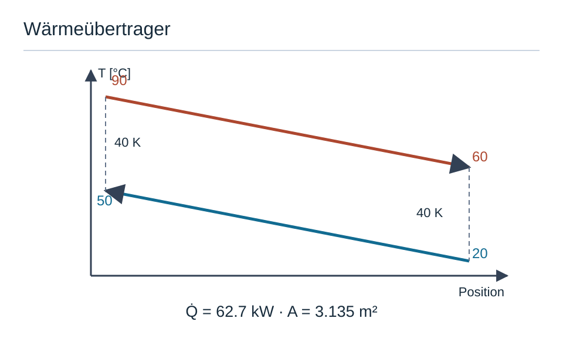

# M6-L6 – Wärmeübertrager {#L6}

**Kursbereich:** M6 – Strömungsmechanik und Wärmetransport

**Niveau:** Bachelor

**Vorwissen:** [M6-L5 – Wärmeleitung, Konvektion und Strahlung](M6-L5.md)

**Lernziel:** Wärmeübertrager mit Energiebilanz und logarithmischer Temperaturdifferenz dimensionieren.

## Einstieg {#S1}

Wärmeübertrager ermöglichen Energieaustausch zwischen Stoffströmen, ohne sie direkt zu mischen. Die treibende Temperaturdifferenz ändert sich entlang des Apparats.

## Grundlagen, Begriffe und Modell {#S2}

Ohne Wärmeverlust nach außen und bei konstanten Wärmekapazitäten gilt $\dot Q=\dot m_h c_{p,h}(T_{h,in}-T_{h,out})=\dot m_c c_{p,c}(T_{c,out}-T_{c,in})$. Für idealen Gegenstrom oder Gleichstrom mit konstantem Gesamtwärmeübergangskoeffizienten U gilt $\dot Q=UA\Delta T_{lm}$, wobei $\Delta T_{lm}=(\Delta T_1-\Delta T_2)/\ln(\Delta T_1/\Delta T_2)$ und bei gleichen Enddifferenzen der gemeinsame Wert verwendet wird.

Im Gegenstrom sind die Enddifferenzen $T_{h,in}-T_{c,out}$ und $T_{h,out}-T_{c,in}$. Im Gleichstrom liegen beide Eintritte am selben Ende. Wenn Austrittstemperaturen unbekannt sind, bietet die Effektivitäts-NTU-Methode einen alternativen Rechenweg.

*Gegenstrom-Wärmeübertrager mit Temperaturverläufen und Enddifferenzen.*

## Durchgerechnetes Beispiel {#S3}

Heißstrom: 90 → 60 °C, Kaltstrom: 20 → 50 °C, beide 0,5 kg/s Wasser mit c_p = 4180 J/(kg K). Wärmeleistung = 62,7 kW. Gegenstrom: beide Enddifferenzen = 40 K. Bei U = 500 W/(m² K) ist A = 62 700/(500·40) = 3,135 m².

## Selbstkontrolle {#S4}

### Aufgaben

1. Wie groß wäre A bei halbiertem U und sonst gleichen Daten?
2. Was passiert bei einer Enddifferenz, die gegen null geht, während die andere positiv bleibt?

::: {.lc-solutions data-lc-section="S4"}
### Lösungen

1. 6,27 m².
2. Die logarithmische Differenz geht gegen null, die für feste Leistung erforderliche Fläche steigt unbegrenzt im Idealmodell.
:::

## Annahmen und Grenzen {#S5}

Stationärer Gegenstrom, konstantes U und c_p, keine Phasenänderung, kein äußerer Wärmeverlust. Verschmutzung und Druckverlust separat bewerten.

## Zusammenfassung und Übergang {#S6}

Energiegleichgewicht legt die Wärmeleistung fest, die Temperaturdifferenz und U bestimmen die Fläche.

**Weiterlesen:** [M7-L1 – Anforderungen und Funktionsstruktur](M7-L1.md)

## Quellen {#S7}

- [MIT OCW – Introduction to Engineering Heat Transfer](https://live.ocw.mit.edu/courses/16-050-thermal-energy-fall-2002/87d9f4544b7fd64a77201382500d057c_10_part3.pdf) · Kapitel 8, HT-50–51: Energiebilanz und logarithmische Temperaturdifferenz im Gegenstrom · Zuletzt abgerufen: 2026-11-25 · Inhaltlich geprüft: 2026-11-25
- [OpenStax – Mechanisms of Heat Transfer](https://openstax.org/books/university-physics-volume-2/pages/1-6-mechanisms-of-heat-transfer) · §1.6 conduction, convection, radiation · Zuletzt abgerufen: 2026-11-25

