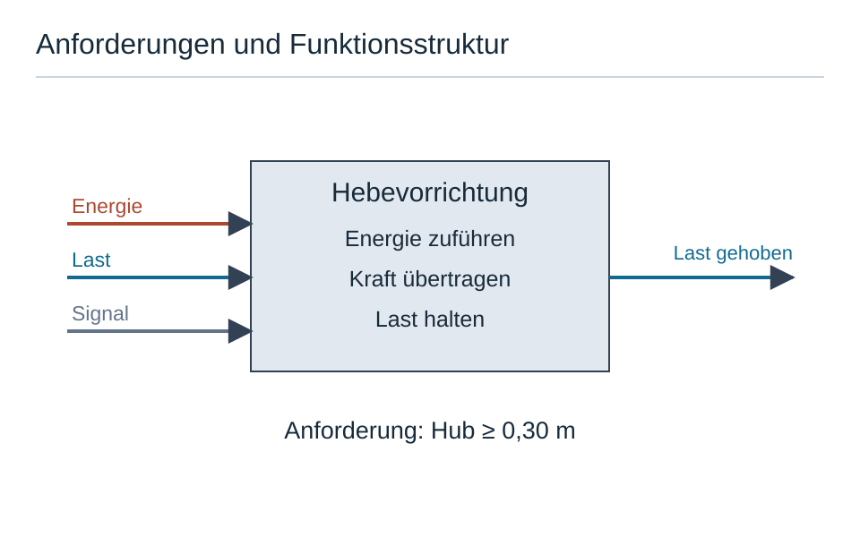

# M7-L1 – Anforderungen und Funktionsstruktur {#L1}

**Kursbereich:** M7 – Konstruktion und CAD

**Niveau:** Bachelor

**Vorwissen:** [M1-L1 – Einheiten, Skalierung und Dimensionsanalyse](M1-L1.md)

**Lernziel:** Anforderungen messbar formulieren und Funktionen von Lösungsprinzipien trennen.

## Einstieg {#S1}

Eine Konstruktion beginnt nicht mit einer Zeichnung, sondern mit einem nachvollziehbaren Problem. Für eine Hebevorrichtung sind Nutzlast, Hubweg, Bedienung, Lebensdauer und Sicherheit zu klären.

## Grundlagen, Begriffe und Modell {#S2}

Eine Anforderung beschreibt eine nachprüfbare Eigenschaft. Muss-Anforderungen begrenzen den zulässigen Lösungsraum; Wünsche können mit Gewichten bewertet werden. Jede Anforderung sollte eine Einheit oder ein Prüfkriterium, einen Grenzwert und eine vorgesehene Verifikationsmethode besitzen. Die Funktion beschreibt, was geleistet werden soll; eine Spindel, ein Seiltrieb und ein Hydraulikzylinder sind unterschiedliche Wirkprinzipien derselben Hebefunktion.

Eine Funktionsstruktur zerlegt die Gesamtfunktion in Teilfunktionen wie Energie zuführen, Kraft übertragen, Last halten und Bewegung begrenzen. Stoff-, Energie- und Signalflüsse machen Schnittstellen sichtbar. Erst anschließend werden Lösungsprinzipien kombiniert. Eine gewichtete Bewertung $S_j=\sum_i w_i r_{ij}$ mit $\sum_i w_i=1$ kann zulässige Varianten vergleichen, wenn alle Bewertungen dieselbe Skala verwenden und höhere Punktzahlen stets die bevorzugte Ausprägung bezeichnen (auch bei Kosten und Masse). Eine Verletzung einer Muss-Anforderung darf jedoch nicht durch hohe Punktzahlen an anderer Stelle kompensiert werden.

*Funktionsstruktur eines Hebegeräts mit Energie-, Stoff- und Signalfluss.*

## Durchgerechnetes Beispiel {#S3}

Zwei bereits zulässige Varianten erhalten für Kosten, Wartung und Masse die Gewichte 0,4/0,35/0,25. A erreicht 4/3/2, B erreicht 3/4/4 von fünf Punkten. A: 1,6+1,05+0,5=3,15. B: 1,2+1,4+1,0=3,60. B wird bevorzugt; eine Sensitivitätsanalyse prüft die Abhängigkeit von den Gewichten.

## Selbstkontrolle {#S4}

### Aufgaben

1. Ist ein niedriger Preis ein Ersatz für einen erforderlichen Überlastschutz?
2. Formuliere ein überprüfbares Hubweg-Kriterium.

::: {.lc-solutions data-lc-section="S4"}
### Lösungen

1. Nein, eine zwingende Sicherheitsanforderung muss erfüllt werden.
2. Beispiel: Hubweg mindestens 0,30 m unter definierter Nutzlast, gemessen mit Wegsensor.
:::

## Annahmen und Grenzen {#S5}

Bewertungsskalen und Gewichte sind modellierte Präferenzen; rechtliche Anforderungen und Risikobeurteilungen sind gesondert zu prüfen.

## Zusammenfassung und Übergang {#S6}

Funktionen sind lösungsneutral; Anforderungen bilden die Grundlage für spätere Nachweise.

**Weiterlesen:** [M7-L2 – Technische Zeichnungen und Bemaßung](M7-L2.md)

## Quellen {#S7}

- [MIT OCW – D-Lab II: Design Packet](https://ocw.mit.edu/courses/ec-720j-d-lab-ii-design-spring-2010/pages/projects/intro/) · Design stages and documentation · Zuletzt abgerufen: 2026-11-25
- [MIT OCW – Mechanical Assembly and Its Role in Product Development](https://ocw.mit.edu/courses/2-875-mechanical-assembly-and-its-role-in-product-development-fall-2004/) · Course description: mating, constraint, tolerances and assembly · Zuletzt abgerufen: 2026-11-25

