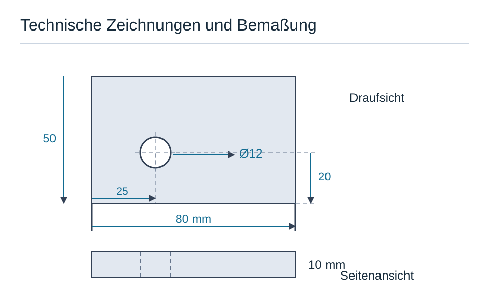

# M7-L2 – Technische Zeichnungen und Bemaßung {#L2}

**Kursbereich:** M7 – Konstruktion und CAD

**Niveau:** Bachelor

**Vorwissen:** [M7-L1 – Anforderungen und Funktionsstruktur](M7-L1.md)

**Lernziel:** Ansichten, Schnitte und funktionsgerechte Maße lesen und erstellen.

## Einstieg {#S1}

Eine technische Zeichnung übermittelt nicht nur die Form, sondern auch die Anforderungen an ein herzustellendes und zu prüfendes Bauteil.

## Grundlagen, Begriffe und Modell {#S2}

Orthogonale Projektionen bilden ein Objekt aus senkrechten Blickrichtungen ab. Vorder-, Seiten- und Draufsicht müssen dieselben Merkmale konsistent darstellen. Schnitte zeigen innere Geometrie; Schnittflächen werden von Hohlräumen unterschieden. Die Anordnung der Ansichten hängt von der festgelegten Projektionsmethode ab. Eine perspektivische Darstellung kann die Lesbarkeit verbessern, ersetzt jedoch keine eindeutigen Fertigungsangaben.

Maßlinien, Maßhilfslinien, Durchmesser- und Radiusangaben beschreiben Sollgeometrie. Funktionsmaße beziehen sich möglichst auf relevante Bezugsflächen. Maßketten addieren Abweichungen; Bezugsbemaßung kann diese Kopplung vermeiden. Zeichnungen benötigen außerdem konsistente Einheiten, Werkstoffangaben, tolerierte Merkmale und einen Revisionsstand. Maße werden gelesen, nicht aus einer gedruckten Darstellung abgemessen.

*Orthogonale Ansichten einer Platte mit Bohrung und Bezugsbemaßung.*

## Durchgerechnetes Beispiel {#S3}

Eine Platte ist 80 mm lang, 50 mm breit und 10 mm dick. Der Mittelpunkt einer durchgehenden Bohrung Ø12 liegt 25 mm von links und 20 mm von unten. Der kleinste nominelle Randsteg beträgt min(25−6, 80−25−6, 20−6, 50−20−6)=14 mm. Die Toleranzanalyse erfolgt separat.

## Selbstkontrolle {#S4}

### Aufgaben

1. Wie wird die Dicke in einer einzelnen Draufsicht nachgewiesen?
2. Warum sollte dieselbe Abmessung nicht mehrfach unabhängig toleriert werden?

::: {.lc-solutions data-lc-section="S4"}
### Lösungen

1. Durch eine eindeutige Dickenangabe; alternativ durch eine zusätzliche Ansicht oder einen Schnitt.
2. Widersprüchliche Sollwerte oder Grenzmaße können Fertigung und Prüfung uneindeutig machen.
:::

## Annahmen und Grenzen {#S5}

Lehrzeichnung, keine normkonforme Fertigungsfreigabe; geltende Projektions-, GPS/GD&T- und Zeichnungsnormen sind vor Nutzung zu bestimmen.

## Zusammenfassung und Übergang {#S6}

Ein eindeutiger Maßbezug verknüpft die Funktion mit Fertigung und Prüfung.

**Weiterlesen:** [M7-L3 – Toleranzen und Passungen](M7-L3.md)

## Quellen {#S7}

- [MIT OCW – Engineering Drawing and Sketching](https://ocw.mit.edu/courses/2-007-design-and-manufacturing-i-spring-2009/pages/related-resources/drawing_and_sketching/) · Orthographic views, dimensioning and assembly drawings · Zuletzt abgerufen: 2026-11-25
- [MIT OCW – Mechanical Assembly and Its Role in Product Development](https://ocw.mit.edu/courses/2-875-mechanical-assembly-and-its-role-in-product-development-fall-2004/) · Course description: mating, constraint, tolerances and assembly · Zuletzt abgerufen: 2026-11-25

