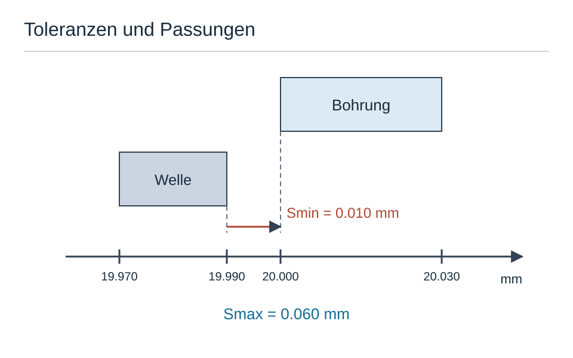

# M7-L3 – Toleranzen und Passungen {#L3}

**Kursbereich:** M7 – Konstruktion und CAD

**Niveau:** Bachelor

**Vorwissen:** [M7-L2 – Technische Zeichnungen und Bemaßung](M7-L2.md)

**Lernziel:** Grenzmaße, Spiel, Übermaß und Worst-Case-Toleranzketten berechnen.

## Einstieg {#S1}

Zwei Bauteile mit gleichem Nennmaß können sich wegen ihrer Fertigungsabweichungen unterschiedlich montieren lassen. Eine Passung wird deshalb über Grenzmaße beschrieben.

## Grundlagen, Begriffe und Modell {#S2}

Mit unterem Grenzmaß $D_{min}$ und oberem Grenzmaß $D_{max}$ beträgt die Maßtoleranz $T_D=D_{max}-D_{min}$. Für eine Bohrung D und Welle d gilt $S_{min}=D_{min}-d_{max}$ und $S_{max}=D_{max}-d_{min}$. Positive Werte bedeuten Spiel, negative Übermaß. Sind beide Werte positiv, liegt eine Spielpassung vor; sind beide negativ, eine Übermaßpassung; bei Vorzeichenwechsel eine Übergangspassung. Null ist der Grenzfall.

Bei einer linearen Maßkette $y=\sum_i a_i x_i$ mit symmetrischen Einzeltoleranzen $\pm t_i$ ist die garantierte Worst-Case-Halbbreite $t_y=\sum_i |a_i|t_i$. Statistische Modelle können unter begründeten Verteilungs- und Unabhängigkeitsannahmen weniger konservative Aussagen liefern, ersetzen aber keine garantierten Grenzmaße. Geometrische Toleranzen, Oberflächen und Temperatur beeinflussen die tatsächliche Montage ebenfalls.

*Grenzmaßfelder von Bohrung und Welle mit minimalem und maximalem Spiel.*

## Durchgerechnetes Beispiel {#S3}

Bohrung 20,000–20,030 mm, Welle 19,970–19,990 mm: S_min=0,010 mm, S_max=0,060 mm. Für eine Lücke y=A−B−C mit A=100±0,10 mm, B=40±0,05 mm und C=59±0,08 mm gilt y=1±0,23 mm; minimal 0,77 mm.

## Selbstkontrolle {#S4}

### Aufgaben

1. Bohrung 20,00–20,02 mm; Welle 20,01–20,03 mm. Welche Passungsart?
2. Was passiert bei Verdopplung aller Einzeltoleranzen?

::: {.lc-solutions data-lc-section="S4"}
### Lösungen

1. Übergangspassung: −0,03 bis +0,01 mm.
2. Die Worst-Case-Halbbreite verdoppelt sich auf 0,46 mm.
:::

## Annahmen und Grenzen {#S5}

Grenzmaße sind didaktisch gewählt, nicht aus einer ISO-Passungstabelle übernommen. Für reale Auswahl aktuelle Normen und Betriebsbedingungen prüfen.

## Zusammenfassung und Übergang {#S6}

Funktionsgerechte Grenzmaße sichern Montierbarkeit und vermeiden unnötig enge Toleranzen.

**Weiterlesen:** [M7-L4 – Parametrisches CAD und Baugruppen](M7-L4.md)

## Quellen {#S7}

- [NISTIR 5615 – Design, specification and tolerancing of micrometer-tolerance assemblies](https://nvlpubs.nist.gov/nistpubs/Legacy/IR/nistir5615.pdf) · Anhang A, S. 21–22: minimales und maximales Spiel sowie Vorzeichen der Passungsarten; Toleranzkette separat hergeleitet · Zuletzt abgerufen: 2026-11-25 · Inhaltlich geprüft: 2026-11-25
- [MIT OCW – Mechanical Assembly and Its Role in Product Development](https://ocw.mit.edu/courses/2-875-mechanical-assembly-and-its-role-in-product-development-fall-2004/) · Course description: mating, constraint, tolerances and assembly · Zuletzt abgerufen: 2026-11-25

