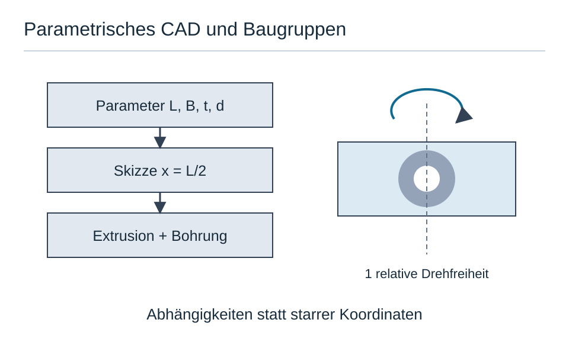

# M7-L4 – Parametrisches CAD und Baugruppen {#L4}

**Kursbereich:** M7 – Konstruktion und CAD

**Niveau:** Bachelor

**Vorwissen:** [M7-L3 – Toleranzen und Passungen](M7-L3.md)

**Lernziel:** Parametrische Modelle und Baugruppenbeziehungen nachvollziehbar aufbauen.

## Einstieg {#S1}

Ein CAD-Modell ist ein geometrisches Modell mit Beziehungen. Es sollte bei Änderungen seine beabsichtigte Funktion erhalten und nicht nur im Ausgangszustand richtig aussehen.

## Grundlagen, Begriffe und Modell {#S2}

Parametrische Modellierung legt Maße und geometrische Beziehungen in einer Skizze fest. Ein Feature wie Extrusion oder Bohrung nutzt diese Geometrie als Eingabe; nachfolgende Features hängen von früheren ab. Aussagekräftige Parameternamen, stabile Bezugsebenen und dokumentierte Abhängigkeiten machen Änderungen reproduzierbar. Eine vollständig bestimmte Skizze hat keine verbleibenden Freiheitsgrade.

Ein freier starrer Körper besitzt im dreidimensionalen Raum sechs Freiheitsgrade: drei Translationen und drei Rotationen. Eine ideale Drehgelenkbeziehung zwischen zwei Körpern lässt genau eine relative Rotation frei. Die Anzahl der unabhängigen Zwangsbedingungen muss zur beabsichtigten Bewegung passen; redundante oder widersprüchliche Bedingungen können die Lösung erschweren. CAD-Kollisionsprüfung prüft Geometrie, nicht automatisch Tragfähigkeit oder Toleranzrobustheit.

*Parametrischer Abhängigkeitsbaum und verbleibende Drehfreiheit einer Baugruppe.*

## Durchgerechnetes Beispiel {#S3}

Eine Platte mit L=80 mm, B=50 mm, t=10 mm und mittiger Bohrung d=12 mm erhält die Parameter x=L/2 und y=B/2. Das Volumen ist V=t(LB−πd²/4)=38 869,03 mm³. Nach Änderung von L auf 100 mm liegt die Bohrung bei x=50 mm und V=48 869,03 mm³.

## Selbstkontrolle {#S4}

### Aufgaben

1. Wie viele unabhängige Freiheitsgrade entfallen beim idealen Drehgelenk?
2. Warum sollte die Bohrung nicht über eine feste x-Koordinate mittig gehalten werden?

::: {.lc-solutions data-lc-section="S4"}
### Lösungen

1. Fünf, relativ zwischen den beiden Körpern.
2. Eine Längenänderung würde die Zentrierung zerstören; x=L/2 bewahrt sie.
:::

## Annahmen und Grenzen {#S5}

Ideale starre Teile; keine elastische Verformung, Fertigungstoleranz oder softwareabhängige Solver-Spezialfälle.

## Zusammenfassung und Übergang {#S6}

Modellparameter dokumentieren Entwurfsabsicht, Baugruppenbedingungen die beabsichtigte Beweglichkeit.

**Weiterlesen:** [M7-L5 – Gestaltungsregeln und Lebenszyklus](M7-L5.md)

## Quellen {#S7}

- [FreeCAD – Parametric objects](https://github.com/FreeCAD/FreeCAD-documentation/blob/main/wiki/Manual_Parametric_objects.md) · Parametric dependencies and model properties · Zuletzt abgerufen: 2026-11-25
- [MIT OCW – Mechanical Assembly and Its Role in Product Development](https://ocw.mit.edu/courses/2-875-mechanical-assembly-and-its-role-in-product-development-fall-2004/) · Course description: mating, constraint, tolerances and assembly · Zuletzt abgerufen: 2026-11-25

