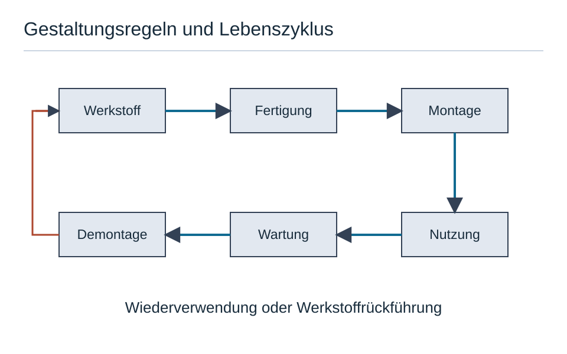

# M7-L5 – Gestaltungsregeln und Lebenszyklus {#L5}

**Kursbereich:** M7 – Konstruktion und CAD

**Niveau:** Bachelor

**Vorwissen:** [M7-L4 – Parametrisches CAD und Baugruppen](M7-L4.md)

**Lernziel:** Gestaltung nach Fertigung, Montage, Wartung und Lebenszyklus bewerten.

## Einstieg {#S1}

Ein leichtes Bauteil ist nicht automatisch wirtschaftlich oder nachhaltig. Entscheidend ist die Funktion über den vorgesehenen Einsatzzeitraum.

## Grundlagen, Begriffe und Modell {#S2}

Fertigungsgerechte Gestaltung vermeidet unnötige Werkzeugwechsel, schwer erreichbare Flächen und nicht erforderliche Genauigkeit. Montagegerechte Gestaltung reduziert Verwechslungsgefahr, erleichtert Positionierung und definiert erreichbare Verbindungen. Wartungsgerechte Gestaltung berücksichtigt Zugänglichkeit, austauschbare Verschleißteile und sichere Stillsetzung. Demontage und Werkstofftrennung sind bereits im Konzept zu berücksichtigen.

Ein Lebenszyklusvergleich braucht eine funktionelle Einheit, identische Systemgrenzen und nachvollziehbare Annahmen. Eine vereinfachte Kostenrechnung kann Anschaffung, Energie, Wartung und Entsorgung addieren; bei längeren Zeiträumen berücksichtigt der Barwert $C=C_0+\sum_{t=1}^{N}C_t/(1+r)^t$ den Kalkulationszins r. Umweltwirkungen sind getrennte Bewertungsgrößen, nicht automatisch durch Geldkosten vertreten.

*Lebenszyklus von Werkstoffwahl bis Demontage und Wiederverwendung.*

## Durchgerechnetes Beispiel {#S3}

A kostet 1000 €, jährlich 300 € für Energie und Wartung; B kostet 1400 €, jährlich 180 €. Bei fünf Jahren, ohne Abzinsung und gleichen Endkosten: A=2500 €, B=2300 €. Der Mehrpreis von B amortisiert sich nach 400/120=3,33 Jahren.

## Selbstkontrolle {#S4}

### Aufgaben

1. Welche Variante ist nach zwei Jahren günstiger?
2. Belegt der Kostenvergleich eine geringere Umweltwirkung von B?

::: {.lc-solutions data-lc-section="S4"}
### Lösungen

1. A: 1600 € gegenüber 1760 € für B.
2. Nein; dazu sind eigene Indikatoren und Lebenszyklusdaten erforderlich.
:::

## Annahmen und Grenzen {#S5}

Hypothetische Kosten, kein vollständiges LCA-Modell. Risiken, Ausfallzeiten, Ressourcen und tatsächliche Betriebsprofile ergänzen.

## Zusammenfassung und Übergang {#S6}

Konstruktion verbindet technische Funktion mit der Herstellung und der gesamten Nutzungsdauer.

**Weiterlesen:** [M8-L1 – Wellen und Achsen](M8-L1.md)

## Quellen {#S7}

- [MIT OCW – Mechanical Assembly and Its Role in Product Development](https://ocw.mit.edu/courses/2-875-mechanical-assembly-and-its-role-in-product-development-fall-2004/) · Course description: mating, constraint, tolerances and assembly · Zuletzt abgerufen: 2026-11-25
- [MIT OCW – D-Lab II: Design Packet](https://ocw.mit.edu/courses/ec-720j-d-lab-ii-design-spring-2010/pages/projects/intro/) · Design stages and documentation · Zuletzt abgerufen: 2026-11-25

