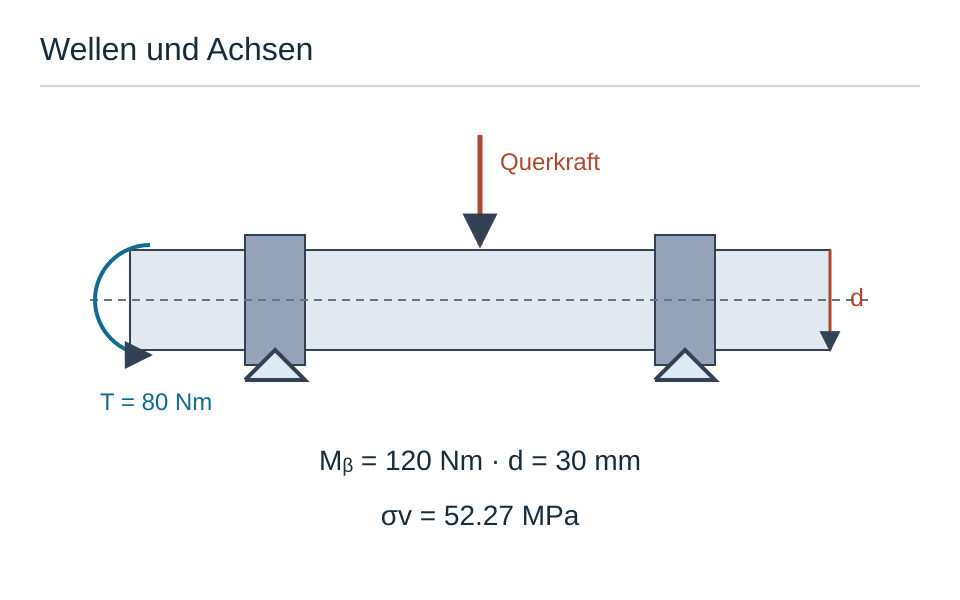

# M8-L1 – Wellen und Achsen {#L1}

**Kursbereich:** M8 – Maschinenelemente

**Niveau:** Bachelor

**Vorwissen:** [M1-L1 – Einheiten, Skalierung und Dimensionsanalyse](M1-L1.md)

**Lernziel:** Wellen und Achsen unterscheiden und nominale kombinierte Spannungen berechnen.

## Einstieg {#S1}

Wellen übertragen Drehmoment, während Achsen primär rotierende Bauteile tragen und in der idealisierten Unterscheidung kein Nutzdrehmoment übertragen. Beide können Biegung erfahren.

## Grundlagen, Begriffe und Modell {#S2}

Für eine massive runde Welle mit Durchmesser d sind die nominalen Randspannungen bei Biegung $\sigma_b=32M_b/(\pi d^3)$ und Torsion $\tau_t=16T/(\pi d^3)$. Bei gleichzeitig wirkender Biegespannung und Schubspannung ist für duktilen Werkstoff die von-Mises-Vergleichsspannung $\sigma_v=\sqrt{\sigma_b^2+3\tau_t^2}$ ein statisches Fließkriterium. Wellenabsätze, Nuten und Bohrungen beeinflussen die lokale Spannung.

Die Drehleistung ist $P=T\omega$, mit $\omega=2\pi n/60$ bei Drehzahl n in min⁻¹. Eine Welle muss neben Festigkeit oft Steifigkeit, Ermüdung, Lagerausrichtung und kritische Drehzahlen erfüllen. Bei rotierender Welle und ortsfester Querkraft kann ein Werkstoffpunkt wechselnde Biegespannung erfahren.

*Welle mit Lagerstellen, Biegemoment und Torsionsmoment.*

## Durchgerechnetes Beispiel {#S3}

d=30 mm, M_b=120 Nm, T=80 Nm. Mit Nmm: σ_b=45,27 MPa, τ_t=15,09 MPa; σ_v=52,27 MPa. Bei n=1500 min⁻¹ beträgt P=12,57 kW.

## Selbstkontrolle {#S4}

### Aufgaben

1. Wie ändern sich die nominalen Spannungen bei d=60 mm?
2. Ist ein bestandener statischer von-Mises-Nachweis ein Ermüdungsnachweis?

::: {.lc-solutions data-lc-section="S4"}
### Lösungen

1. Sie sinken auf ein Achtel, bei unveränderten Momenten.
2. Nein; Lastwechsel, Mittelspannung, Kerben und Werkstoffdaten sind gesondert zu berücksichtigen.
:::

## Annahmen und Grenzen {#S5}

Glatter Vollquerschnitt, linear-elastisch, keine zusätzlichen Normalkräfte; kein Bemessungsnachweis für einen realen Antrieb.

## Zusammenfassung und Übergang {#S6}

Die Momentenbilanz liefert die Beanspruchung, die Geometrie bestimmt die nominale Spannung.

**Weiterlesen:** [M8-L2 – Schrauben und Verbindungen](M8-L2.md)

## Quellen {#S7}

- [MIT OCW – Elements of Mechanical Design: Lecture Notes](https://ocw.mit.edu/courses/2-72-elements-of-mechanical-design-spring-2009/pages/lecture-notes/) · Lecture index: shafts, bearings, bolted joints, gears, clutches and brakes; PDFs not individually reviewed · Zuletzt abgerufen: 2026-11-25
- [MIT OCW – Mechanics of Materials (Fall 1999)](https://ocw.mit.edu/courses/3-11-mechanics-of-materials-fall-1999/) · Course Description; Spannung/Dehnung, Fachwerk, Torsion, Biegung; weiterführende Einzeltexte offen · Zuletzt abgerufen: 2026-11-25
- [OpenStax – University Physics 1: Work and Power for Rotational Motion](https://openstax.org/books/university-physics-volume-1/pages/10-8-work-and-power-for-rotational-motion) · §10.8 torque, work and power · Zuletzt abgerufen: 2026-11-25

