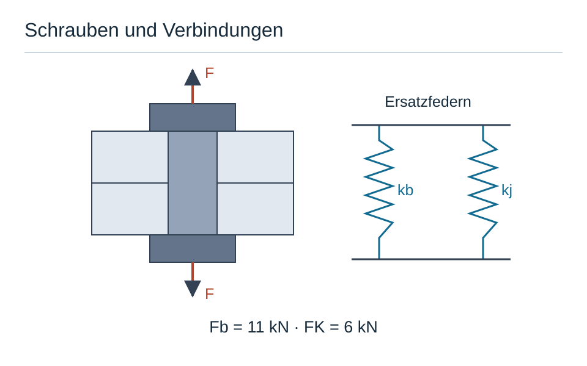

# M8-L2 – Schrauben und Verbindungen {#L2}

**Kursbereich:** M8 – Maschinenelemente

**Niveau:** Bachelor

**Vorwissen:** [M8-L1 – Wellen und Achsen](M8-L1.md)

**Lernziel:** Vorspannung, Lastaufteilung und Restklemmkraft im vereinfachten Federersatzmodell bestimmen.

## Einstieg {#S1}

Schrauben verbinden Teile lösbar. Eine Vorspannung hält die Fügeflächen zusammen und beeinflusst die Belastung bei äußerer Zugkraft.

## Grundlagen, Begriffe und Modell {#S2}

Bei Montage entsteht eine Schraubenzugkraft $F_V$ und eine gleich große Klemmkraft. Für den idealisierten axialen Lastfall mit Lasteinleitung an den äußeren Klemmflächen seien Schraubensteifigkeit $k_b$ und Klemmteilsteifigkeit $k_j$ gegeben. Der Kraftanteil $\Phi=k_b/(k_b+k_j)$ beschreibt den Zuwachs der Schraubenkraft durch eine äußere Trennkraft F. Solange Kontakt besteht, gilt $F_b=F_V+\Phi F$ und $F_K=F_V-(1-\Phi)F$.

Die Grenze der vereinfachten Kontaktbedingung liegt bei $F=F_V/(1-\Phi)$. Nach Trennung gilt das vorherige lineare Modell nicht mehr. Drehmomentverfahren besitzen Streuung durch Reibung; Setzen, Temperatur und dynamische Belastung können die Vorspannung ändern. Stoffschlüssige, formschlüssige und kraftschlüssige Verbindungen übertragen Kräfte durch unterschiedliche Mechanismen.

*Vorgespanntes Schraubengelenk und Ersatzfedern für Schraube und Klemmteile.*

## Durchgerechnetes Beispiel {#S3}

F_V=10 kN, k_b=100 kN/mm, k_j=400 kN/mm und F=5 kN. Φ=0,2; F_b=11 kN, F_K=6 kN. Kontaktverlust im Modell bei 12,5 kN.

## Selbstkontrolle {#S4}

### Aufgaben

1. Wie groß ist F_K bei F=8 kN?
2. Ist Φ=0,2 für jede Schraubenverbindung gültig?

::: {.lc-solutions data-lc-section="S4"}
### Lösungen

1. 10−0,8·8=3,6 kN.
2. Nein, es hängt von Geometrie, Steifigkeiten und Lasteinleitung ab.
:::

## Annahmen und Grenzen {#S5}

Einzelne zentrisch belastete Schraube, lineare Steifigkeiten und bestehender Kontakt. Reale Nachweise benötigen Schraubenkennwerte, Lastkollektiv und geeignete Bemessungsregeln.

## Zusammenfassung und Übergang {#S6}

Vorspannung und Steifigkeitsverhältnis bestimmen gemeinsam die Lastaufteilung.

**Weiterlesen:** [M8-L3 – Wälz- und Gleitlager](M8-L3.md)

## Quellen {#S7}

- [NASA – Preloaded Bolted Joint Analysis Methodology (Engineering Library reproduction)](https://engineeringlibrary.org/reference/preloaded-bolted-joint-analysis-methodology-nasa) · Preload, bolt and joint stiffness, joint separation · Zuletzt abgerufen: 2026-11-25
- [MIT OCW – Elements of Mechanical Design: Lecture Notes](https://ocw.mit.edu/courses/2-72-elements-of-mechanical-design-spring-2009/pages/lecture-notes/) · Lecture index: shafts, bearings, bolted joints, gears, clutches and brakes; PDFs not individually reviewed · Zuletzt abgerufen: 2026-11-25

