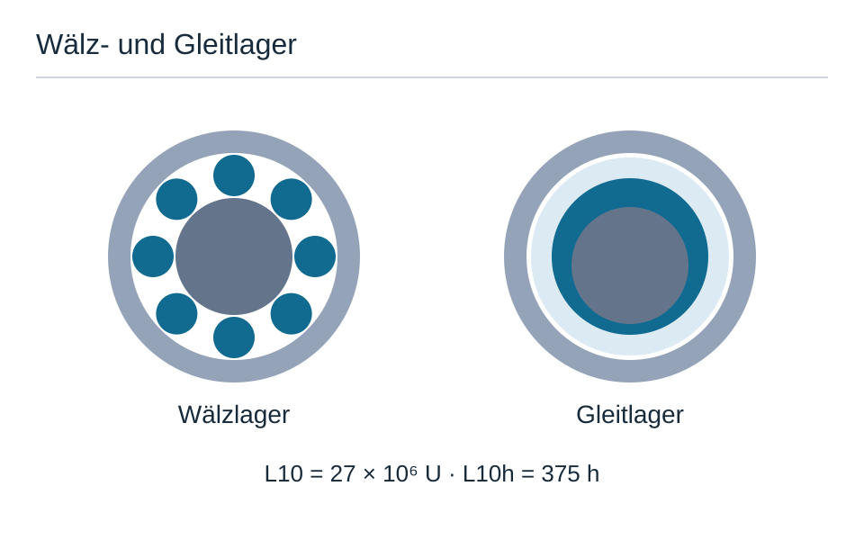

# M8-L3 – Wälz- und Gleitlager {#L3}

**Kursbereich:** M8 – Maschinenelemente

**Niveau:** Bachelor

**Vorwissen:** [M8-L2 – Schrauben und Verbindungen](M8-L2.md)

**Lernziel:** Lagerbauarten vergleichen und die nominelle Wälzlagerlebensdauer berechnen.

## Einstieg {#S1}

Lager führen bewegte Bauteile und übertragen Kräfte auf das Gehäuse. Die Auswahl hängt neben der Last von Drehzahl, Reibung, Bauraum und Betriebsumgebung ab.

## Grundlagen, Begriffe und Modell {#S2}

Wälzlager verwenden rollende Körper zwischen Laufbahnen; Gleitlager arbeiten mit gleitenden Oberflächen und gegebenenfalls einem tragenden Schmierfilm. Ein Festlager begrenzt typischerweise die axiale Lage, ein Loslager erlaubt temperaturbedingte axiale Verschiebung. Die tatsächliche Anordnung hängt von Lagerbauart und Lastfall ab.

Für eine konstante dynamische äquivalente Lagerbelastung P und dynamische Tragzahl C ergibt sich die nominelle Lebensdauer $L_{10}=(C/P)^p$ in Millionen Umdrehungen, mit $p=3$ für Kugellager und $p=10/3$ für Rollenlager. Unter den Modellbedingungen entspricht L10 einer Überlebenswahrscheinlichkeit von 90 % für eine Gruppe gleichartiger Lager. Bei konstanter Drehzahl n in min⁻¹ gilt $L_{10h}=10^6 L_{10}/(60n)$. Statische Tragfähigkeit, Verschmutzung, Schmierung und Temperatur sind gesondert zu beurteilen.

*Wälzlager und Gleitlager im Querschnitt sowie nominelle Lagerlebensdauer.*

## Durchgerechnetes Beispiel {#S3}

Kugellager: C=30 kN, P=10 kN, n=1200 min⁻¹. L10=3³=27 Millionen Umdrehungen; L10h=27 000 000/72 000=375 h. Bei P=5 kN steigt die nominelle Lebensdauer auf 216 Millionen Umdrehungen beziehungsweise 3000 h.

## Selbstkontrolle {#S4}

### Aufgaben

1. Verdoppelt halbierte Drehzahl die nominelle Lebensdauer in Umdrehungen?
2. Ist L10 eine garantierte Mindestlebensdauer jedes Lagers?

::: {.lc-solutions data-lc-section="S4"}
### Lösungen

1. Nein, nur die Lebensdauer in Stunden verdoppelt sich im unveränderten Lastmodell.
2. Nein, eine statistische nominelle Kenngröße.
:::

## Annahmen und Grenzen {#S5}

Konstantes P und n, nominelles Ermüdungsmodell; reale Lagerauswahl erfordert Herstellerdaten und weitere Ausfallkriterien.

## Zusammenfassung und Übergang {#S6}

Die nominelle Lebensdauer reagiert stark auf die äquivalente Belastung.

**Weiterlesen:** [M8-L4 – Zahnradgetriebe](M8-L4.md)

## Quellen {#S7}

- [SKF Evolution – The SKF formula for rolling bearing life](https://evolution.skf.com/the-skf-formula-for-rolling-bearing-life/) · Basic life relation and bearing-type exponent · Zuletzt abgerufen: 2026-11-25
- [MIT OCW – Elements of Mechanical Design: Lecture Notes](https://ocw.mit.edu/courses/2-72-elements-of-mechanical-design-spring-2009/pages/lecture-notes/) · Lecture index: shafts, bearings, bolted joints, gears, clutches and brakes; PDFs not individually reviewed · Zuletzt abgerufen: 2026-11-25

