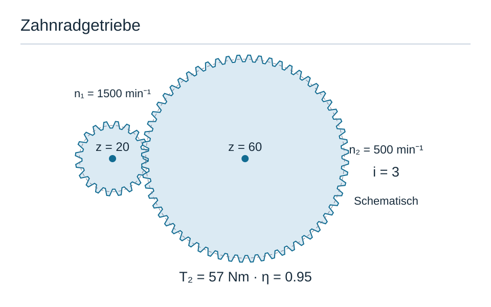

# M8-L4 – Zahnradgetriebe {#L4}

**Kursbereich:** M8 – Maschinenelemente

**Niveau:** Bachelor

**Vorwissen:** [M8-L3 – Wälz- und Gleitlager](M8-L3.md)

**Lernziel:** Übersetzung, Drehmoment und Zahnkraft eines einfachen Stirnradpaares bestimmen.

## Einstieg {#S1}

Getriebe passen Drehzahl und Drehmoment an den Arbeitsprozess an. Ein Zahnradpaar überträgt die Bewegung durch den Eingriff der Zähne.

## Grundlagen, Begriffe und Modell {#S2}

Für zwei außenverzahnte Stirnräder ist die Betragsübersetzung $i=|n_1/n_2|=z_2/z_1$. Die Drehrichtungen sind entgegengesetzt. Der Modul m verknüpft Teilkreisdurchmesser und Zähnezahl: $d=mz$. Bei unveränderten Standard-Bezugsprofilen ohne Profilverschiebung beträgt der nominelle Achsabstand $a=(d_1+d_2)/2$. Im stationären Antrieb gilt mit Wirkungsgrad $\eta=P_2/P_1$ die Betragsbeziehung $T_2=\eta i T_1$.

Die tangentiale Zahnkraft am Bezugsdurchmesser des antreibenden Rades ist $F_t=2T_1/d_1$. Für das idealisierte gerade Evolventen-Zahnpaar folgt aus dem Eingriffswinkel $\alpha$ eine radiale Komponente $F_r=F_t\tan\alpha$. Zahnfußspannung, Flankentragfähigkeit, Geräusch und Schmierung erfordern weitere Modelle. Mehrstufige Übersetzungen multiplizieren sich, sofern Leistungsweg und Vorzeichen eindeutig festgelegt sind.

*Stirnradpaar mit Zähnezahlen, Drehzahl und Teilkreisen.*

## Durchgerechnetes Beispiel {#S3}

z₁=20, z₂=60, m=2 mm, n₁=1500 min⁻¹, T₁=20 Nm, η=0,95. d₁=40 mm, d₂=120 mm, a=80 mm; i=3, n₂=500 min⁻¹ im Betrag, T₂=57 Nm. F_t=40/0,04=1000 N; bei α=20° ist F_r≈364 N.

## Selbstkontrolle {#S4}

### Aufgaben

1. Welche Abtriebsdrehzahl ergibt eine zweite Untersetzungsstufe i=2?
2. Steigt die Leistung bei einem idealen Untersetzungsgetriebe?

::: {.lc-solutions data-lc-section="S4"}
### Lösungen

1. 250 min⁻¹ im Betrag.
2. Nein, das Drehmoment steigt auf Kosten der Drehzahl; ideal bleibt die Leistung gleich.
:::

## Annahmen und Grenzen {#S5}

Stationär, vereinfachte Kraftzerlegung ohne Reibung im Zahneingriff; der Gesamtwirkungsgrad ist separat vorgegeben. Keine Zahnradfestigkeitsfreigabe.

## Zusammenfassung und Übergang {#S6}

Übersetzung folgt aus der Geometrie; Verluste begrenzen das verfügbare Drehmoment.

**Weiterlesen:** [M8-L5 – Federn, Kupplungen und Bremsen](M8-L5.md)

## Quellen {#S7}

- [MIT OCW – Elements of Mechanical Design: Lecture Notes](https://ocw.mit.edu/courses/2-72-elements-of-mechanical-design-spring-2009/pages/lecture-notes/) · Lecture index: shafts, bearings, bolted joints, gears, clutches and brakes; PDFs not individually reviewed · Zuletzt abgerufen: 2026-11-25
- [OpenStax – University Physics 1: Work and Power for Rotational Motion](https://openstax.org/books/university-physics-volume-1/pages/10-8-work-and-power-for-rotational-motion) · §10.8 torque, work and power · Zuletzt abgerufen: 2026-11-25

