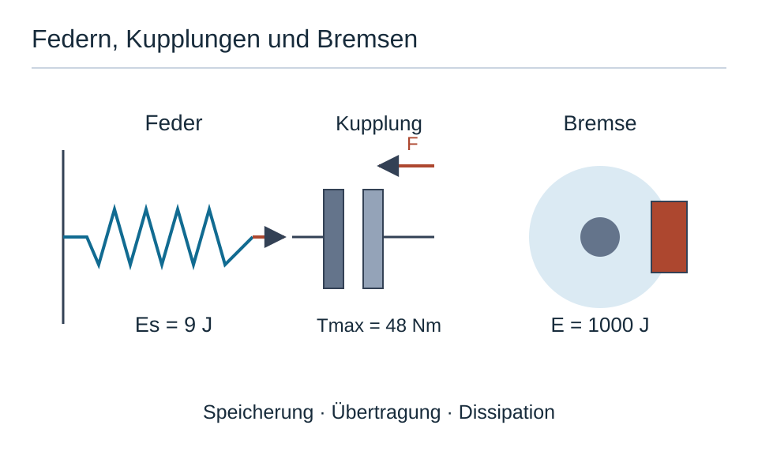

# M8-L5 – Federn, Kupplungen und Bremsen {#L5}

**Kursbereich:** M8 – Maschinenelemente

**Niveau:** Bachelor

**Vorwissen:** [M8-L4 – Zahnradgetriebe](M8-L4.md)

**Lernziel:** Elastische Energie und einfache Reibmomentmodelle unterscheiden.

## Einstieg {#S1}

Federn speichern mechanische Energie. Kupplungen verbinden Antriebe, während Bremsen eine Bewegung verzögern oder halten. Diese Bauteile können hohe thermische und mechanische Belastungen erfahren.

## Grundlagen, Begriffe und Modell {#S2}

Für eine lineare Feder gilt für den Betrag der Kraft bei nichtnegativem Auslenkungsbetrag x: $F=kx$ und speichert $E_s=kx^2/2$ relativ zur entspannten Lage. Reale Federn können Vorspannung, nichtlineare Kennlinien und Ermüdung zeigen. Eine Reibkupplung überträgt Drehmoment über Normalkraft und Reibung. Bei einem vereinfachten Modell mit n gleich belasteten Reibflächen, Anpresskraft F je Fläche, Reibwert $\mu$ und effektivem Radius $r_e$ gilt $T_{max}=n\mu F r_e$. Der effektive Radius hängt von Druck- bzw. Verschleißverteilung ab.

Bei Schlupf entsteht Wärmeleistung $P_{loss}=T|\omega_1-\omega_2|$. Für eine Bremse, die einen isolierten Rotor ohne äußere Arbeitszufuhr anhält, wird die kinetische Energie $E=J\omega^2/2$ in andere Energieformen umgewandelt, überwiegend Wärme. Wiederholte Bremsungen erfordern eine Wärmebilanz und Temperaturgrenzen.

*Lineare Feder, Reibkupplung und Bremse mit Energieübertragung.*

## Durchgerechnetes Beispiel {#S3}

Feder: k=20 kN/m, x=0,03 m → F=600 N, E_s=9 J. Kupplung: n=2, μ=0,3, F=1000 N je Fläche, r_e=0,08 m → T_max=48 Nm. Bei übertragenen 40 Nm und 10 rad/s Schlupf entstehen 400 W Verlustleistung. Ein Rotor mit J=0,2 kg m² und ω=100 rad/s besitzt 1000 J Rotationsenergie.

## Selbstkontrolle {#S4}

### Aufgaben

1. Wie ändert sich die Federenergie bei doppeltem Weg?
2. Warum kann eine Kupplung im Schlupfbetrieb thermisch überlasten?

::: {.lc-solutions data-lc-section="S4"}
### Lösungen

1. Sie vervierfacht sich auf 36 J.
2. Die Differenzdrehzahl erzeugt bei übertragenem Moment eine kontinuierliche Wärmeleistung.
:::

## Annahmen und Grenzen {#S5}

Konstante Reibwerte, idealisierte Kontaktverteilung, lineare Feder; keine Auslegung einer sicherheitskritischen Bremse.

## Zusammenfassung und Übergang {#S6}

Kraft- und Drehmomentkapazität müssen gemeinsam mit Energie und Wärme betrachtet werden.

**Weiterlesen:** [M8-L6 – Tribologie und Schmierung](M8-L6.md)

## Quellen {#S7}

- [OpenStax – University Physics 1: Potential Energy of a System](https://openstax.org/books/university-physics-volume-1/pages/8-1-potential-energy-of-a-system) · §8.1 ideal spring energy · Zuletzt abgerufen: 2026-11-25
- [MIT OCW – Elements of Mechanical Design: Lecture Notes](https://ocw.mit.edu/courses/2-72-elements-of-mechanical-design-spring-2009/pages/lecture-notes/) · Lecture index: shafts, bearings, bolted joints, gears, clutches and brakes; PDFs not individually reviewed · Zuletzt abgerufen: 2026-11-25
- [OpenStax – University Physics 1: Work and Power for Rotational Motion](https://openstax.org/books/university-physics-volume-1/pages/10-8-work-and-power-for-rotational-motion) · §10.8 torque, work and power · Zuletzt abgerufen: 2026-11-25

