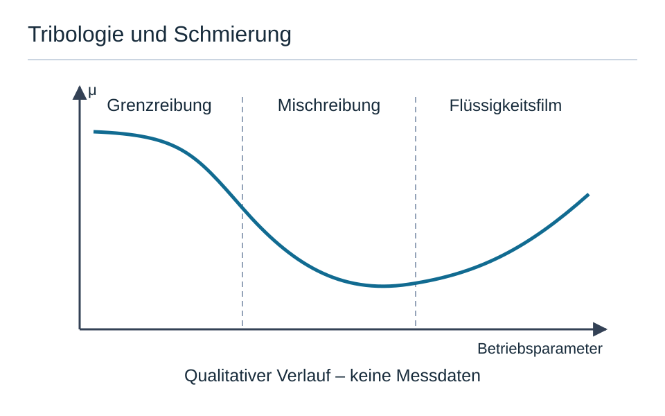

# M8-L6 – Tribologie und Schmierung {#L6}

**Kursbereich:** M8 – Maschinenelemente

**Niveau:** Bachelor

**Vorwissen:** [M8-L5 – Federn, Kupplungen und Bremsen](M8-L5.md)

**Lernziel:** Reibung, Verschleiß und Schmierungsregime unterscheiden und Reibverlust abschätzen.

## Einstieg {#S1}

Tribologie behandelt das Zusammenwirken bewegter Kontaktflächen. Ein niedriger Reibwert allein garantiert weder geringen Verschleiß noch zuverlässigen Betrieb.

## Grundlagen, Begriffe und Modell {#S2}

In einem einfachen Coulomb-Modell ist die Gleitreibung $F_R=\mu F_N$ und die dissipierte Leistung $P_R=F_Rv$. Der Reibwert hängt in realen Kontakten von Material, Oberflächenzustand, Temperatur, Schmierung und Geschwindigkeit ab. Adhäsiver und abrasiver Verschleiß beruhen auf unterschiedlichen Mechanismen; Ermüdung an wiederholt belasteten Kontakten ist ein weiterer Schadensweg.

Bei Grenzschmierung trägt die Oberfläche einen erheblichen Lastanteil. In Mischreibung tragen Rauheitsspitzen und Schmierfilm gemeinsam, bei vollständiger Flüssigkeitsfilmschmierung trennt der Film die Festkörper weitgehend. Die qualitative Stribeck-Kurve stellt den Reibwert gegen einen Betriebsparameter dar, der typischerweise mit Viskosität und Geschwindigkeit steigt und mit spezifischer Belastung sinkt. Der genaue Parameter hängt von der Kontaktgeometrie ab. Bei hohem Filmanteil kann viskose Scherung die Reibung wieder erhöhen.

*Schematische Stribeck-Kurve mit Grenz-, Misch- und Flüssigkeitsreibung.*

## Durchgerechnetes Beispiel {#S3}

F_N=2000 N, v=0,5 m/s. Bei μ=0,12 gilt F_R=240 N und P_R=120 W; bei μ=0,03 gilt F_R=60 N und P_R=30 W. Der vereinfachte Verlust sinkt um 90 W beziehungsweise 75 %.

## Selbstkontrolle {#S4}

### Aufgaben

1. Verdoppelt sich die Reibleistung bei doppeltem v im konstanten Coulomb-Modell?
2. Beweist ein niedriger μ-Wert einen dauerhaft tragfähigen Schmierfilm?

::: {.lc-solutions data-lc-section="S4"}
### Lösungen

1. Ja; im realen Kontakt kann sich zugleich μ ändern.
2. Nein; Filmzustand, Temperatur und Verschleiß müssen separat beurteilt werden.
:::

## Annahmen und Grenzen {#S5}

Schematische Kurve ohne Kalibrierung; vor realer Schmierstoffwahl Last, Geschwindigkeit, Temperatur, Materialverträglichkeit und Herstellervorgaben prüfen.

## Zusammenfassung und Übergang {#S6}

Tribologische Auslegung optimiert das gesamte Kontaktsystem, nicht nur einen Reibwert.

**Weiterlesen:** [M9-L1 – Urformen und Umformen](M9-L1.md)

## Quellen {#S7}

- [MIT OCW – Tribology: Syllabus](https://ocw.mit.edu/courses/2-800-tribology-fall-2004/pages/syllabus/) · Course overview: friction, wear and lubrication · Zuletzt abgerufen: 2026-11-25
- [MIT OCW – Tribology: Lecture Notes](https://ocw.mit.edu/courses/2-800-tribology-fall-2004/pages/lecture-notes/) · Lecture index: friction, wear, lubrication · Zuletzt abgerufen: 2026-11-25
- [OpenStax – Work-Energy Theorem](https://openstax.org/books/university-physics-volume-1/pages/7-3-work-energy-theorem) · §7.3 work and kinetic energy · Zuletzt abgerufen: 2026-11-25

