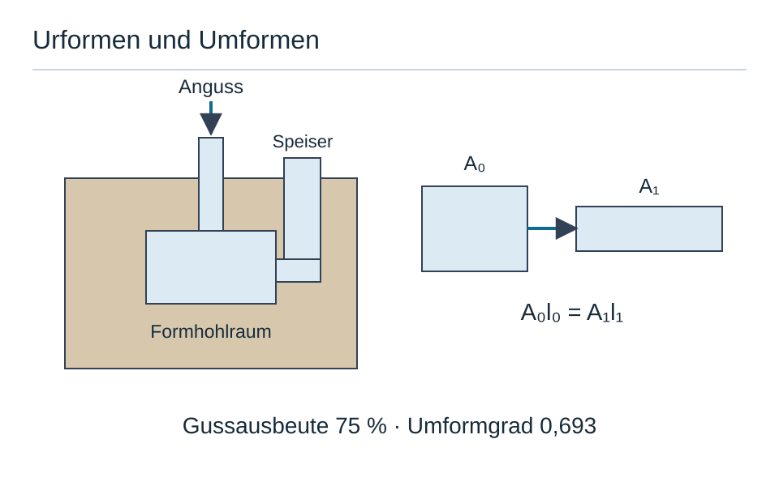

# M9-L1 – Urformen und Umformen {#L1}

**Kursbereich:** M9 – Fertigung und Produktion

**Niveau:** Bachelor

**Vorwissen:** [M1-L1 – Einheiten, Skalierung und Dimensionsanalyse](M1-L1.md)

**Lernziel:** Urformen und Umformen unterscheiden und Materialausbeute sowie Umformgrad berechnen.

## Einstieg {#S1}

Ein Gehäuse kann aus einer Schmelze gegossen oder aus einem bereits festen Halbzeug geformt werden. Die Wahl beeinflusst Gefüge, Oberflächen, Toleranzen und Kosten.

## Grundlagen, Begriffe und Modell {#S2}

Beim Urformen entsteht ein fester Körper aus zunächst formlosem Material. Beim Gießen füllt eine Schmelze den Formhohlraum; Erstarrung und Schrumpfung müssen konstruktiv berücksichtigt werden. Speiser können Flüssigmetall nachliefern, Entlüftungen ermöglichen Gasabfuhr. Porosität und Lunker gefährden die Tragfähigkeit. Die Form kann verloren gehen (Sandguss) oder wiederverwendet werden (Kokillenguss). Die Gussausbeute ist $\eta_m=m_{Teil}/m_{Einsatz}$; Rücklaufmaterial darf nicht automatisch als Abfall betrachtet werden.

Beim Umformen bleibt der Werkstoff im Wesentlichen zusammenhängend. Walzen, Schmieden, Strangpressen und Tiefziehen nutzen plastisches Fließen; Druck- und Zugspannungen sind prozessabhängig. Kaltumformung erhöht häufig die Festigkeit durch Verfestigung, während Warmumformung geringere Fließspannungen ermöglichen kann. Unter idealer Volumenkonstanz gilt $A_0l_0=A_1l_1$. Der logarithmische Längenumformgrad ist $\varphi=\ln(l_1/l_0)$; er ist von der technischen Dehnung zu unterscheiden.

*Gießen mit Anguss und Speiser sowie plastisches Umformen eines Rohlings.*

## Durchgerechnetes Beispiel {#S3}

Ein Gussstück wiegt 6 kg, mit Anguss und Speisern werden 8 kg Metall benötigt. Die Ausbeute ist 6/8 = 75 %. Ein ideal umgeformter Stab mit A₀ = 200 mm² und l₀ = 100 mm wird auf A₁ = 100 mm² reduziert. Dann l₁ = 200 mm und φ = ln(2) = 0,693.

## Selbstkontrolle {#S4}

### Aufgaben

1. Welche Ausbeute ergeben 5 kg Teilmasse aus 8 kg Einsatz?
2. Warum können Speiser nicht einfach entfallen?

::: {.lc-solutions data-lc-section="S4"}
### Lösungen

1. 62,5 %.
2. Sie können den Volumenverlust während der Erstarrung ausgleichen.
:::

## Annahmen und Grenzen {#S5}

Ideal plastisches Fließen ohne Materialverlust, Temperatur- oder Reibungsgradienten; für Werkzeugkräfte, Erstarrung und Defekte sind weiterführende Modelle erforderlich.

## Zusammenfassung und Übergang {#S6}

Urformen erzeugt den festen Körper, Umformen verändert seine Geometrie. Ausbeute allein entscheidet nicht über die Prozesswahl.

**Weiterlesen:** [M9-L2 – Spanen und CNC](M9-L2.md)

## Quellen {#S7}

- [MIT OCW – Design and Manufacturing II (2025): Lecture Notes](https://ocw.mit.edu/courses/2-008-design-and-manufacturing-ii-spring-2025/lists/lecture-notes/) · Lecture index 5–12, 16–21 and 23; individual PDFs not reviewed · Zuletzt abgerufen: 2026-11-25

