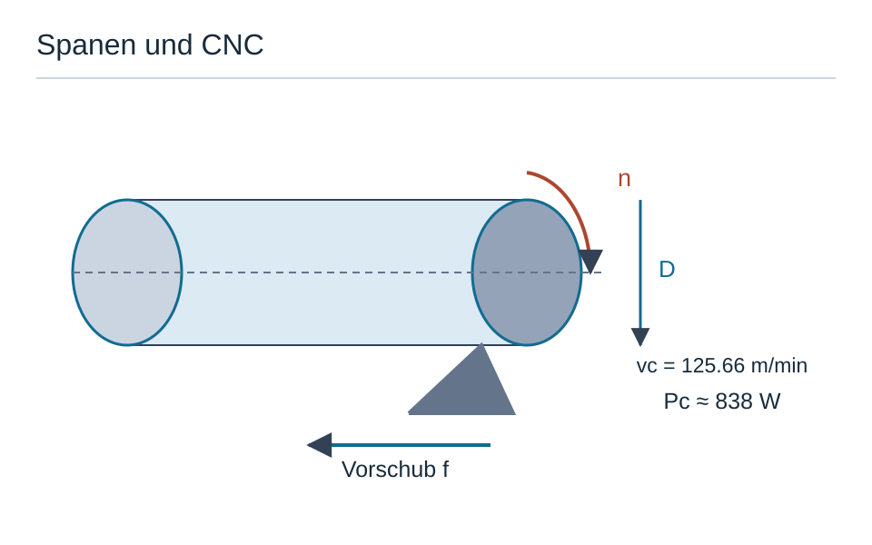

# M9-L2 – Spanen und CNC {#L2}

**Kursbereich:** M9 – Fertigung und Produktion

**Niveau:** Bachelor

**Vorwissen:** [M9-L1 – Urformen und Umformen](M9-L1.md)

**Lernziel:** Schnittgeschwindigkeit, Drehzahl, Vorschubgeschwindigkeit und idealisierte Schnittleistung bestimmen.

## Einstieg {#S1}

Spanen trennt Werkstoff gezielt ab. Eine CNC-Steuerung koordiniert Bewegungen, ersetzt aber weder Prozessplanung noch Kollisionsprüfung.

## Grundlagen, Begriffe und Modell {#S2}

Beim Drehen rotiert überwiegend das Werkstück, beim Fräsen ein mehrschneidiges Werkzeug. Schneidengeometrie, Spanbildung, Reibung und Wärme bestimmen Werkzeugverschleiß und Oberflächenqualität. Schnittgeschwindigkeit $v_c=\pi Dn/1000$ gilt bei D in mm, n in min⁻¹ und v_c in m/min. Beim Drehen ist die Vorschubgeschwindigkeit $v_f=fn$ mit Vorschub f in mm/U. Die Schnittleistung ist $P_c=F_cv_c/60$ in W, wenn F_c in N und v_c in m/min eingesetzt wird. Die Motorleistung muss Verluste und zusätzliche Belastungen berücksichtigen.

CAD beschreibt das Bauteil; CAM erzeugt Werkzeugbahnen aus Geometrie, Aufspannung, Werkzeugen und Fertigungsstrategie. Ein Postprozessor übersetzt diese Bahnen für die konkrete Steuerung. Bezugssysteme, Werkzeugkorrekturen, Rohteil und Spannmittel müssen konsistent modelliert sein. Eine Simulation deckt manche, aber nicht alle Kollisionen und Prozessprobleme auf. Eine reale Einrichtung erfordert qualifiziertes Personal und freigegebene Betriebsabläufe.

*Drehprozess mit Werkstückdurchmesser, Vorschubrichtung und Schnittbewegung.*

## Durchgerechnetes Beispiel {#S3}

Für ein rein rechnerisches Drehbeispiel sind D = 50 mm, n = 800 min⁻¹, f = 0,20 mm/U und F_c = 400 N gegeben. v_c = π·50·800/1000 = 125,66 m/min, v_f = 160 mm/min. P_c = 400·125,66/60 = 838 W. Das sind keine Einstellvorgaben für eine reale Maschine.

## Selbstkontrolle {#S4}

### Aufgaben

1. Was passiert mit v_c bei halbiertem Durchmesser und gleicher Drehzahl?
2. Wie groß ist v_f bei 0,1 mm/U und 800 min⁻¹?

::: {.lc-solutions data-lc-section="S4"}
### Lösungen

1. Sie halbiert sich.
2. 80 mm/min.
:::

## Annahmen und Grenzen {#S5}

Stationäre idealisierte Größen; tatsächliche Werte hängen von Werkstoff, Werkzeug, Kühlung, Maschine und Sicherheitsgrenzen ab.

## Zusammenfassung und Übergang {#S6}

Die Schnittkinematik verbindet Geometrie und Prozesszeit; CAM und CNC setzen eine geprüfte Planung um.

**Weiterlesen:** [M9-L3 – Fügen und Oberflächen](M9-L3.md)

## Quellen {#S7}

- [MIT OCW – Design and Manufacturing II (2025): Lecture Notes](https://ocw.mit.edu/courses/2-008-design-and-manufacturing-ii-spring-2025/lists/lecture-notes/) · Lecture index 5–12, 16–21 and 23; individual PDFs not reviewed · Zuletzt abgerufen: 2026-11-25

