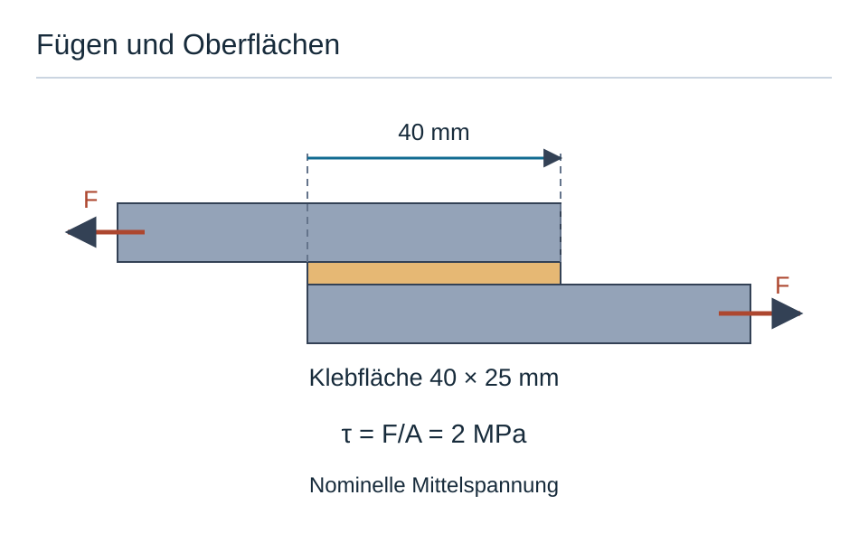

# M9-L3 – Fügen und Oberflächen {#L3}

**Kursbereich:** M9 – Fertigung und Produktion

**Niveau:** Bachelor

**Vorwissen:** [M9-L2 – Spanen und CNC](M9-L2.md)

**Lernziel:** Fügeverfahren anhand Kraftpfad und Oberflächenanforderungen vergleichen.

## Einstieg {#S1}

Eine Baugruppe muss Lasten übertragen und möglicherweise lösbar, dicht, elektrisch leitfähig oder korrosionsbeständig sein.

## Grundlagen, Begriffe und Modell {#S2}

Schrauben und Nieten übertragen Kräfte durch Form- oder Kraftschluss, abhängig von Verbindung und Belastung. Schweißen, Löten und Kleben erzeugen stoffschlüssige Verbindungen. Beim Schweißen kann eine Wärmeeinflusszone das Gefüge und die mechanischen Eigenschaften verändern; beim Löten schmilzt in der Regel das Lot, nicht der Grundwerkstoff. Klebverbindungen verteilen Lasten auf eine Fläche, sind aber empfindlich gegenüber Oberflächenzustand, Alterung und Schälbelastung. Die nominelle mittlere Schubspannung ist $\tau=F/A$; der tatsächliche Spannungsverlauf ist besonders an den Enden einer Überlappung ungleichmäßig.

Oberflächenbearbeitung verändert Geometrie, Topografie oder Randzoneneigenschaften. Schleifen und Polieren können Rauheit reduzieren, Beschichtungen können Verschleiß oder Korrosion beeinflussen, und mechanische Randzonenbehandlung kann Eigenspannungen verändern. Rauheit, Maßhaltigkeit, Haftung und Sauberkeit sind unterschiedliche Anforderungen. Die Prüfung richtet sich nach Funktion und Fehlerfolgen, nicht nur nach optischer Qualität.

*Überlappte Klebverbindung mit nomineller Schubfläche und Kraftpfad.*

## Durchgerechnetes Beispiel {#S3}

Eine Klebefläche von 40 × 25 mm trägt nominell 2 kN Schubkraft. A = 1000 mm² und τ = 2000/1000 = 2 MPa. Gegenüber einer hypothetischen Vergleichsgröße von 6 MPa ergibt sich ein Verhältnis von 3; dies ist kein belastbarer Sicherheitsnachweis, da Spannungsspitzen, Schälanteile und Alterung fehlen.

## Selbstkontrolle {#S4}

### Aufgaben

1. Was ergibt doppelte Fläche bei gleicher Kraft im Mittelspannungsmodell?
2. Warum reicht eine glänzende Oberfläche nicht als Qualitätsbeleg?

::: {.lc-solutions data-lc-section="S4"}
### Lösungen

1. Halbe mittlere Schubspannung, also 1 MPa.
2. Rauheit, Haftung, Defekte und funktionelle Eigenschaften müssen passend geprüft werden.
:::

## Annahmen und Grenzen {#S5}

Keine Freigabe eines Schweiß-, Kleb- oder Oberflächenprozesses; reale Nachweise benötigen geprüfte Verfahrensdaten und belastungsgerechte Prüfungen.

## Zusammenfassung und Übergang {#S6}

Fügetechnik und Oberfläche bilden gemeinsam einen funktionsbestimmenden Teil der Konstruktion.

**Weiterlesen:** [M9-L4 – Additive Fertigung](M9-L4.md)

## Quellen {#S7}

- [MIT OCW – Design and Manufacturing II (2025): Lecture Notes](https://ocw.mit.edu/courses/2-008-design-and-manufacturing-ii-spring-2025/lists/lecture-notes/) · Lecture index 5–12, 16–21 and 23; individual PDFs not reviewed · Zuletzt abgerufen: 2026-11-25

