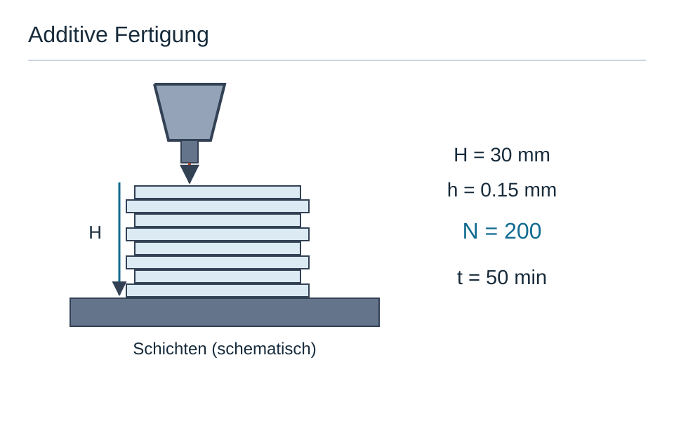

# M9-L4 – Additive Fertigung {#L4}

**Kursbereich:** M9 – Fertigung und Produktion

**Niveau:** Bachelor

**Vorwissen:** [M9-L3 – Fügen und Oberflächen](M9-L3.md)

**Lernziel:** Additive Prozessfamilien vergleichen und eine vereinfachte Bauzeit abschätzen.

## Einstieg {#S1}

Additive Fertigung kann komplexe Geometrie ermöglichen, verändert jedoch die Beziehung zwischen Entwurf, Fertigung und Bauteileigenschaften.

## Grundlagen, Begriffe und Modell {#S2}

Bei Materialextrusion wird Material durch eine Düse aufgetragen. Pulverbettverfahren verbinden ausgewählte Bereiche einer Pulverschicht; bei gerichteter Energieeinbringung werden Materialzufuhr und Aufschmelzen kombiniert. Badphotopolymerisation härtet ein lichtempfindliches Harz lokal aus. Die Verfahren unterscheiden sich in Werkstoff, Auflösung, Bauraum, Nachbearbeitung und Prozessrisiken. Die Orientierung beeinflusst Stützstrukturen, Oberflächen und richtungsabhängige Eigenschaften; das bloße Vorhandensein eines CAD-Modells garantiert kein funktionsfähiges Teil.

Für ein Bauteil der Höhe H und konstante Schichtdicke h ist die geometrische Schichtzahl $N=\lceil H/h\rceil$. Ein grobes Bauzeitmodell lautet $t=t_0+Nt_s$, wobei t_s eine angenommene mittlere Zeit pro Schicht einschließlich Schichtwechsel ist. Reale Prozesse haben unterschiedliche Querschnittsflächen, Weglängen und zusätzliche Schritte wie Abkühlen, Entfernen von Stützen, Wärmebehandlung und Prüfung. Kritische Bauteile benötigen qualifizierte Material- und Prozessdaten.

*Schichtweiser Materialauftrag und Schichtzählung eines vereinfachten Bauteils.*

## Durchgerechnetes Beispiel {#S3}

H = 30 mm, h = 0,15 mm, t_s = 12 s und t₀ = 600 s. N = 200, t = 600 + 200·12 = 3000 s = 50 min. Für die gleiche mittlere Schichtzeit würde h = 0,10 mm zu 300 Schichten und 70 min führen.

## Selbstkontrolle {#S4}

### Aufgaben

1. Wie viele Schichten sind bei H = 10,1 mm und h = 0,2 mm geometrisch erforderlich?
2. Warum ist die Schichtzahl allein kein Zeitmodell?

::: {.lc-solutions data-lc-section="S4"}
### Lösungen

1. Aufgerundet 51.
2. Schichtfläche, Bewegung, Belichtung und Nebenzeiten beeinflussen die tatsächliche Bauzeit.
:::

## Annahmen und Grenzen {#S5}

Die Modellschichtzeiten sind angenommene Werte, keine Maschinenparameter. Kein Ersatz für Prozessqualifizierung, Arbeits- oder Brandschutz.

## Zusammenfassung und Übergang {#S6}

Additive Fertigung ist eine Familie unterschiedlicher Verfahren; Orientierung und Nachbearbeitung müssen in der Planung berücksichtigt werden.

**Weiterlesen:** [M9-L5 – Prozessketten und Produktionsplanung](M9-L5.md)

## Quellen {#S7}

- [MIT OCW – Design and Manufacturing II (2025): Lecture Notes](https://ocw.mit.edu/courses/2-008-design-and-manufacturing-ii-spring-2025/lists/lecture-notes/) · Lecture index 5–12, 16–21 and 23; individual PDFs not reviewed · Zuletzt abgerufen: 2026-11-25
- [NIST – Additive Manufacturing Technologies](https://www.nist.gov/additive-manufacturing/research-areas/technologies) · Process families: powder bed fusion, deposition, extrusion, photopolymerization, jetting · Zuletzt abgerufen: 2026-11-25

