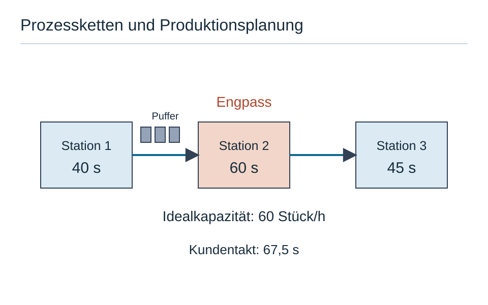

# M9-L5 – Prozessketten und Produktionsplanung {#L5}

**Kursbereich:** M9 – Fertigung und Produktion

**Niveau:** Bachelor

**Vorwissen:** [M9-L4 – Additive Fertigung](M9-L4.md)

**Lernziel:** Prozessketten analysieren, Engpasskapazität und idealisierten Durchsatz bestimmen.

## Einstieg {#S1}

Ein schneller Einzelprozess macht noch keine schnelle Fertigungslinie. Entscheidend sind Abhängigkeiten, Verfügbarkeit und Materialfluss.

## Grundlagen, Begriffe und Modell {#S2}

Die Arbeitsplanung legt Reihenfolge, Betriebsmittel, Aufspannungen, Prüfungen und benötigte Ressourcen fest. Eine Prozesskette verbindet diese Arbeitsgänge. Bearbeitungszeit ist die aktive Zeit am Werkstück, Durchlaufzeit enthält außerdem Warte-, Transport- und Rüstanteile. Bei seriellen Einzelstationen ohne Ausschuss und Störungen ist die maximale stationäre Rate $R_{max}=\min_i(1/t_i)$; die größte Taktzeit t_i begrenzt den Durchsatz. Puffer können kurzfristige Schwankungen entkoppeln, schaffen aber keine zusätzliche langfristige Engpasskapazität.

Der Kundentakt ist verfügbare Produktionszeit dividiert durch Nachfrage. Er ist ein Planungsziel, keine automatisch erreichbare Prozesszeit. Für ein stabiles System gilt langfristig Little's Law $L=RW$, mit mittlerem Bestand L, Durchsatz R und mittlerer Durchlaufzeit W. Systemgrenze und Bezugszeit müssen zusammenpassen. Rüstungen, Störungen, Qualitätsverluste und schwankende Nachfrage erfordern realistischere Kapazitätsmodelle.

*Drei serielle Fertigungsstationen mit Engpass und Puffer.*

## Durchgerechnetes Beispiel {#S3}

Drei Stationen benötigen 40, 60 und 45 s pro Stück. Der ideale Engpass liegt bei Station 2: 3600/60 = 60 Stück/h. Für 7,5 h verfügbare Zeit und 400 geforderte Stück ergibt sich Kundentakt = 27000/400 = 67,5 s. Bei tatsächlich 50 Stück/h und 25 Stück mittlerem Bestand ist W = 25/50 = 0,5 h.

## Selbstkontrolle {#S4}

### Aufgaben

1. Welchen idealen Durchsatz ergibt eine Verringerung von Station 2 auf 50 s?
2. Muss ein Puffer möglichst groß sein?

::: {.lc-solutions data-lc-section="S4"}
### Lösungen

1. 72 Stück/h; Station 2 bleibt Engpass.
2. Nein. Größere Puffer können bei tatsächlicher Belegung den Bestand erhöhen; bei gleichem Durchsatz steigt dann die mittlere Durchlaufzeit. Nutzen und Kosten sind abzuwägen.
:::

## Annahmen und Grenzen {#S5}

Ideale stationäre Kapazität ohne Anfahrzeiten, Störungen oder Ausschuss. Little’s Law verwendet langfristige Mittelwerte eines stabilen Systems.

## Zusammenfassung und Übergang {#S6}

Engpass, Kundentakt und Durchlaufzeit sind verschiedene Größen. Produktionsplanung muss sie gemeinsam betrachten.

**Weiterlesen:** [M9-L6 – Qualität und Prozessfähigkeit](M9-L6.md)

## Quellen {#S7}

- [MIT OCW – Design and Manufacturing II (2025): Lecture Notes](https://ocw.mit.edu/courses/2-008-design-and-manufacturing-ii-spring-2025/lists/lecture-notes/) · Lecture index 5–12, 16–21 and 23; individual PDFs not reviewed · Zuletzt abgerufen: 2026-11-25
- [MIT OCW – Introduction to Manufacturing Systems](https://ocw.mit.edu/courses/2-854-introduction-to-manufacturing-systems-fall-2016/) · Course description: material flow, capacities, bottlenecks and planning · Zuletzt abgerufen: 2026-11-25

