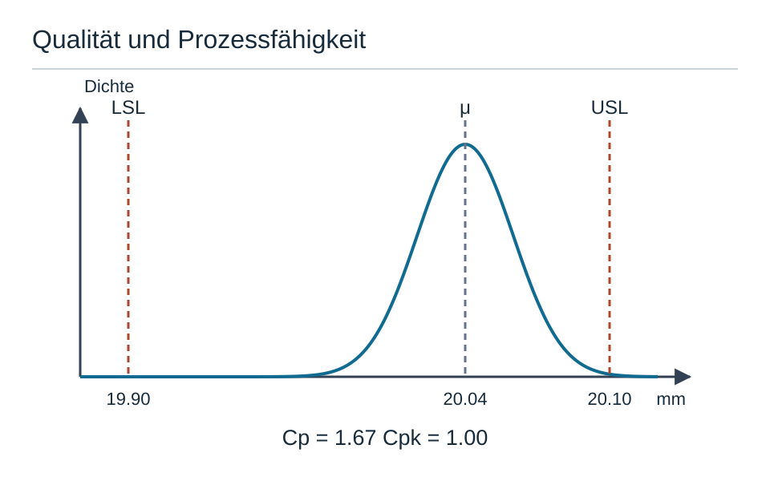

# M9-L6 – Qualität und Prozessfähigkeit {#L6}

**Kursbereich:** M9 – Fertigung und Produktion

**Niveau:** Bachelor

**Vorwissen:** [M9-L5 – Prozessketten und Produktionsplanung](M9-L5.md)

**Lernziel:** Prozessstabilität und Prozessfähigkeit unterscheiden und Cp und Cpk berechnen.

## Einstieg {#S1}

Eine Welle kann heute innerhalb der Toleranz liegen, obwohl der Prozess langfristig nicht beherrscht ist. Einzelprüfung und Prozessüberwachung haben verschiedene Ziele.

## Grundlagen, Begriffe und Modell {#S2}

Spezifikationsgrenzen LSL und USL stammen aus funktionalen Produktanforderungen. Regelgrenzen einer statistischen Prozessregelkarte werden dagegen aus Prozessdaten ermittelt. Ein stabiler Prozess zeigt keine erkennbaren Sonderursachen; Stabilität bedeutet nicht automatisch, dass die Streuung zur Spezifikation passt. Erst nach Beurteilung der Stabilität und des Messsystems ist eine Fähigkeitsanalyse sinnvoll.

Für einen hinreichend stabilen, annähernd normalverteilten Prozess werden die Indizes mit Stichprobenmittelwert $\bar x$ und Standardabweichung s geschätzt: $C_p=(USL-LSL)/(6s)$ und $C_{pk}=\min[(USL-\bar x)/(3s),(\bar x-LSL)/(3s)]$. Cp beurteilt die verfügbare Toleranzbreite gegenüber der Streuung; Cpk berücksichtigt zusätzlich die Mittelwertlage. Beide sind Schätzwerte und erfordern geeignete, repräsentative Daten. Hier wird s als Schätzer der Streuung des stabilen Prozesses verwendet; bei Teilgruppen ist die vereinbarte Schätzmethode zu beachten, insbesondere die Abgrenzung zur Gesamtstreuung bei Pp und Ppk. Die geforderte Fähigkeit ergibt sich aus Anwendung und Qualitätsvereinbarung, nicht aus einer universellen Freigabegrenze.

*Normalverteilung eines stabil gedachten Prozesses mit verschobenem Mittelwert und Spezifikationsgrenzen.*

## Durchgerechnetes Beispiel {#S3}

Eine hypothetisch stabile Fertigung hat LSL = 19,90 mm, USL = 20,10 mm, Mittelwert = 20,04 mm und s = 0,02 mm. Cp = 0,20/0,12 = 1,67. Cpk = min(0,06/0,06; 0,14/0,06) = 1,00. Die Streuung ist relativ klein, aber die Mittelwertverschiebung reduziert Cpk.

## Selbstkontrolle {#S4}

### Aufgaben

1. Wie groß ist Cpk bei einem Mittelwert von 20,00 mm und gleicher Streuung?
2. Sind Regelgrenzen dasselbe wie Toleranzgrenzen?

::: {.lc-solutions data-lc-section="S4"}
### Lösungen

1. 1,67, gleich Cp.
2. Nein, Regelgrenzen beschreiben Prozessverhalten, Spezifikationen die Anforderungen.
:::

## Annahmen und Grenzen {#S5}

Normale Verteilung und Stabilität sind Modellannahmen. Bei kleinen, abhängigen oder nichtnormalen Stichproben sind geeignete alternative Auswertungen und Unsicherheitsangaben nötig.

## Zusammenfassung und Übergang {#S6}

Prozessfähigkeit verbindet Streuung, Zentrierung und Spezifikation; die Messkette ist Teil der Qualitätssicherung.

**Weiterlesen:** [M10-L1 – Messketten und Unsicherheit](M10-L1.md)

## Quellen {#S7}

- [MIT OCW – Design and Manufacturing II (2025): Lecture Notes](https://ocw.mit.edu/courses/2-008-design-and-manufacturing-ii-spring-2025/lists/lecture-notes/) · Lecture index 5–12, 16–21 and 23; individual PDFs not reviewed · Zuletzt abgerufen: 2026-11-25
- [NIST/SEMATECH e-Handbook – What is Process Capability?](https://www.itl.nist.gov/div898/handbook/pmc/section1/pmc16.htm) · §6.1.6: Cp, Cpk, estimation and distribution assumptions · Zuletzt abgerufen: 2026-11-25

